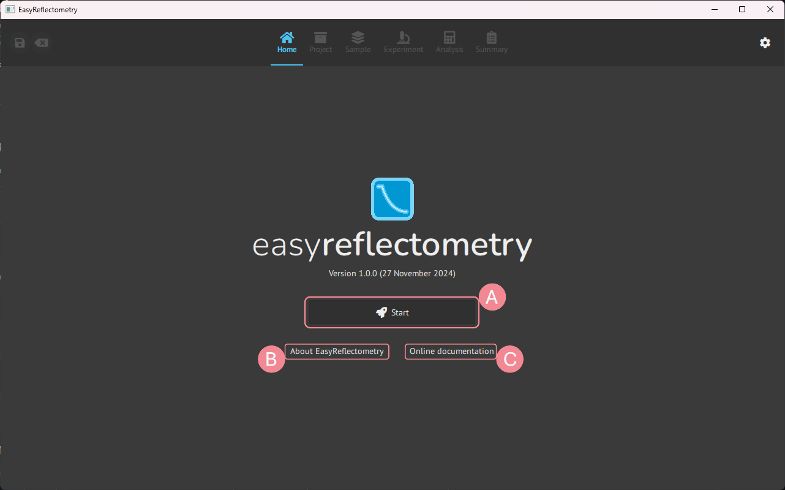
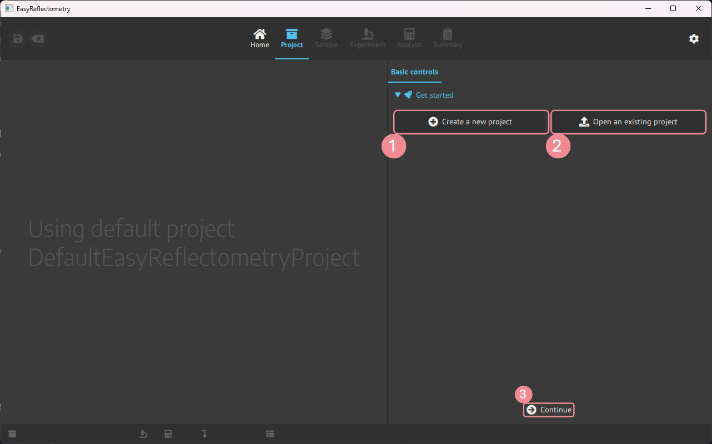
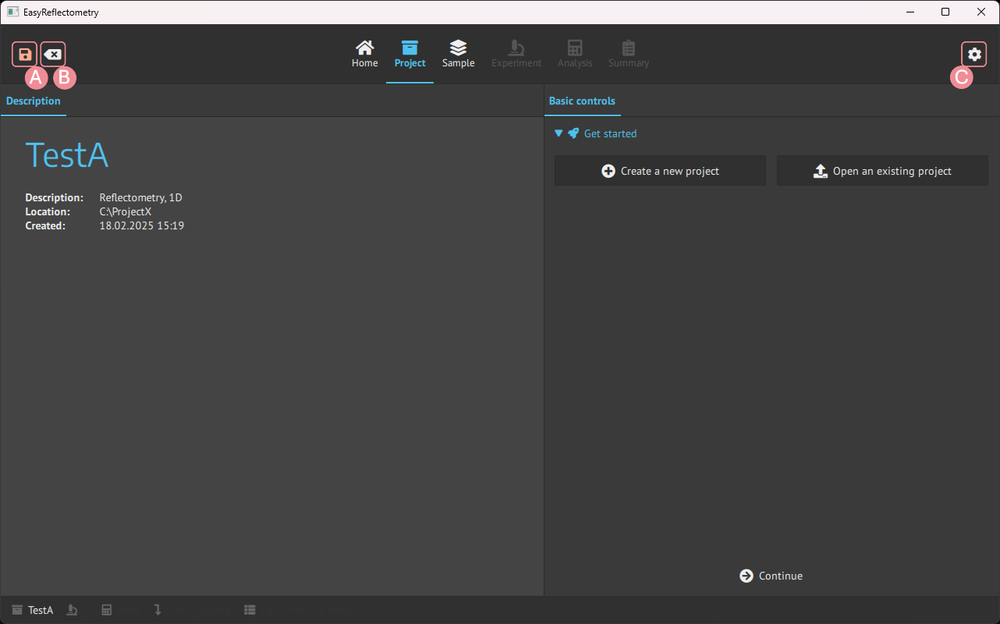

# Getting started
This tutorial explains how to use EasyReflectometryApp.
Version: 1.6.1

## Home page
EasyReflectometryApp opens on the **Home** page.



- **A**: Starts your project.
- **B**: Pop-up window with source information.
- **C**: Link to developer documentation.

Below them, **Tutorials** lists the tutorials that can be followed step by step in the app.
Clicking one loads its example project (asking first if that would discard unsaved work) and
opens a panel on the left of the pages. For each step the panel gives the instructions, frames
the control to use, and ticks the step off once it is done. **Show me** performs the step,
**Skip step** moves on without it, and **Stop** closes the panel and leaves the project as it
is. A tutorial finished without skipping a step is marked with a tick in the list. The
[simple fitting](./tutorials/simple_fitting.md) and [magnetic layers](./tutorials/magnetism.md)
tutorials show their steps on their pages as well.

## Initialise project

Pressing **A** takes you to the **Project** page.



- **1**: Creates a new project: a folder containing experiments and a JSON settings file.
   - A new project needs a name, a description and a save location.
- **2**: Opens an existing project from its JSON file.
- **3**: Continues to the next page, which here is **Model**.
    - This button appears throughout the app and always takes you to the next page.


If you do not create or select a project, the app starts a default project.
The rest of this tutorial uses that default project.

### Creating a new project
**Create a new project** opens a dialog for the project's name, description and location.
**OK** creates the project; **Cancel** closes the dialog without creating anything.

If the session already contains your own sample, data or fit settings, either built before
any project existed or belonging to the open project, the app first asks what the new
project should start with:

- **Keep sample and data**: the new project starts with what is on screen.
- **Start from scratch**: the new project starts with the default sample and no data.
- **Cancel**: no new project is created.

The dialog also tells you whether the current work has been saved. Starting from scratch
discards any work that was never saved to a project. Nothing is reset until you confirm the
new project's details with **OK**, so cancelling at that point keeps everything as it was.

```{note}
Later versions cannot open projects saved by EasyReflectometry 1.5 or earlier.
Re-create them, or open them with EasyReflectometry 1.5.
```

## Save and settings
Once a project is started, two more buttons appear, with the settings button in the
opposite corner.



- **A**: Save project.
- **B**: Reset to start.
- **C**: Settings, explained in the settings section.

### Automatic saving
Once you have created a project, the app also saves it automatically if it has unsaved
changes at any of these moments:

- when you leave a page;
- after a successful fit, and after a Bayesian sampling run;
- just before a fit starts, before the calculation engine is switched, and before the
  sample is replaced by one loaded from an ORSO file.

The app never saves automatically while a fit is running.

Before each automatic save, the app copies the project file it is about to replace to
`project.json.bak` in the project folder, so you can undo one unwanted automatic save by
hand. Saving with the save button (**A**) does not create a backup.

The **Saved** item in the status bar shows the time of the last save, followed by `(auto)`
if that save was automatic. In that case its tooltip shows the path of the backup. If an
automatic save fails, a dialog tells you once, and the status bar shows **Autosave failed**
until a save succeeds. Your work is still in memory, so use the save button to try again.

To turn off automatic saving, untick **Save automatically** in the **Saving** group of the
`Advanced controls` on the `Project` page. This is an application preference: it is
remembered between sessions and applies to every project.

## Sample structure view
The **Model** page has a **Structure** tab next to **Reflectivity**. It shows a diagram of
the current model's layer stack, with one coloured box per layer, the ambient medium at the
top and the substrate at the bottom. Layers of the same material share a colour (see the
legend), box heights follow layer thickness, and multilayers with many repetitions are
drawn once with a "× N" badge.

Hover over a box to see its material, SLD, thickness and roughness, and click it to select
that layer in the sidebar editor. The view updates as soon as the model changes, including
after a fit.

The view is a diagram and not drawn to scale. Box heights are limited so that very thin
layers stay visible and very thick ones do not push the others out of view.
