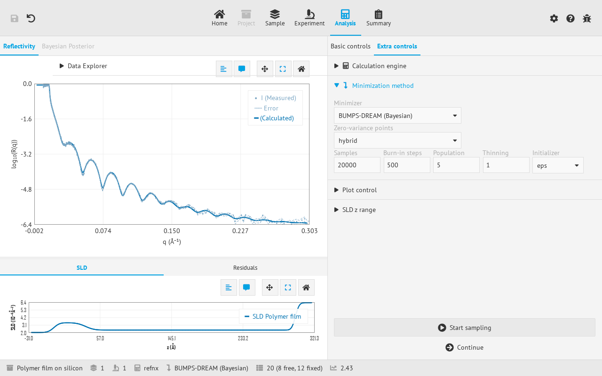
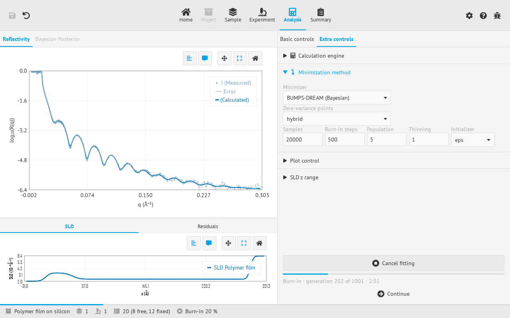
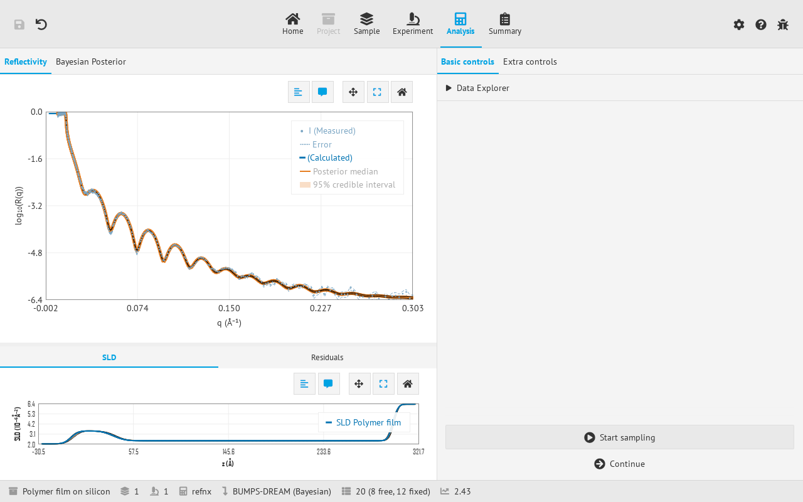
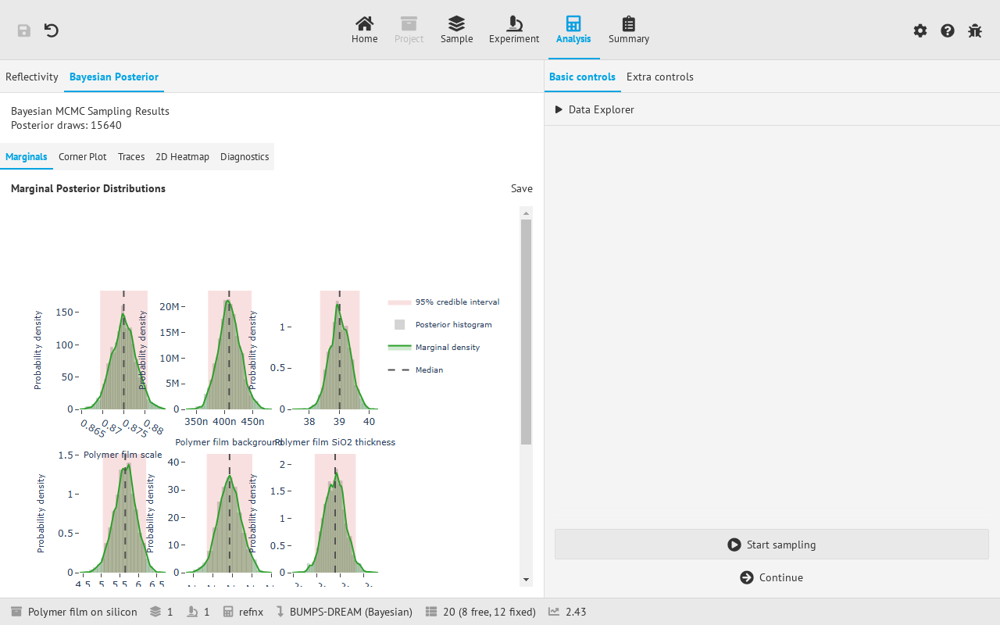
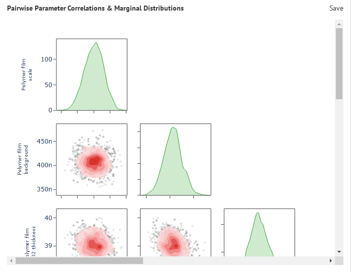
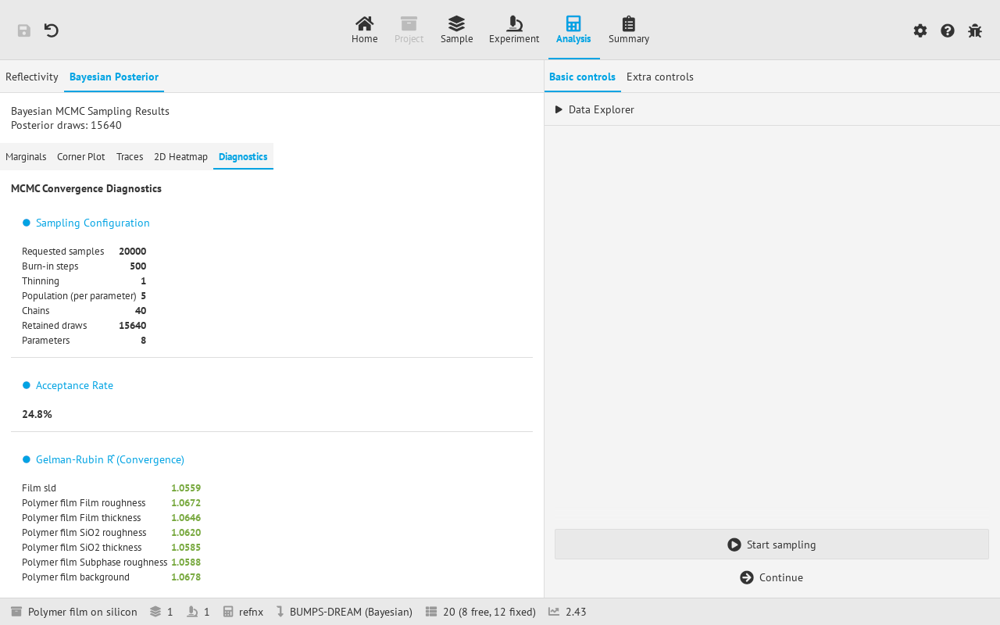

# Bayesian analysis

Besides the classical minimisers, the app can sample the posterior distribution of the
fitted parameters with the BUMPS DREAM sampler. For each parameter you then get a
distribution instead of a single best value: a median, a credible interval, and the
correlations between parameters.

This tutorial samples the *Polymer film on silicon* example, the system of
[simple fitting](./simple_fitting.md): a polymer film on oxidised silicon, in D2O. Load it
from the examples on the `Project` page.

## 1. Fit first

On the `Analysis` page, press **Start fitting** with the default minimiser, `Bumps_lm`.
The fit takes a few seconds.

The sampler's chains start close to the current parameter values (see **Initializer**
below). Starting them at the best fit means less burn-in is spent walking towards it.

## 2. Choose the sampler and its settings

Open `Extra controls` › `Minimization method` and choose **BUMPS-DREAM (Bayesian)**, the
first entry of the **Minimizer** drop-down. **Tolerance** and **Max evaluations** are
replaced by the sampler's settings:



| Setting | Meaning |
|---|---|
| **Samples** | Number of draws to record, over all chains together. |
| **Burn-in steps** | Generations run and thrown away before recording starts, while the chains settle into the posterior. |
| **Population** | Chains per sampled parameter. The sampler runs population × parameters chains. |
| **Thinning** | Record every n-th generation, to reduce autocorrelation. |
| **Initializer** | Where the chains start: `eps` and `cov` close to the current values, `lhs` and `random` spread over the parameter ranges. |

The parameters sampled are the ones selected for fitting in the parameter table of the
`Basic controls`. Each remains between its **Min** and **Max**. **Zero-variance points**
applies to sampling as it does to a fit; see *Limitations* at the end of this page.

### How long a run takes

Each generation evaluates the model once per chain. A run therefore costs about
*chains × burn-in steps + samples* model evaluations, where *chains* is
*population × sampled parameters*.

The example samples 8 parameters. With the default settings (10000 samples, 2000 burn-in
steps, population 10) that is 80 chains and about 170000 evaluations: around an hour on a
laptop. For this tutorial, set

- **Samples** 20000,
- **Burn-in steps** 500,
- **Population** 5.

That is 40 chains and about 40000 evaluations, which took 20 minutes on a laptop. Fewer
chains with a longer burn-in converge better for the same cost than the reverse.

## 3. Run the sampler

With the Bayesian minimiser selected, the button below the sidebar (on both the
`Basic controls` and the `Extra controls` tabs) reads **Start sampling** instead of
**Start fitting**. Press it.

While the run is in progress, a progress bar and a line of text under the button show how
far it has got: the phase (**Burn-in**, then **Sampling**), the current generation out of
the total, and the elapsed time.



A thin bar along the top of the status bar shows the same, with a short form such as
`Sampling 42 %`, on every page except `Home`. A classical fit, by comparison, has no known
end: its bar only shows that it is running (see [simple fitting](./simple_fitting.md)).

During the run the button reads **Cancel fitting**, and the parameter table cannot be
edited. After you cancel, the progress bar dims and the table stays locked until the
sampler has stopped, so an old run cannot write into the parameters of the next one.
Nothing from a cancelled run is kept: a dialog titled *Cancelled* says so, and the
parameters keep their previous values.

## 4. Read the results

When the run finishes, a dialog lists the number of posterior draws and the sampled
parameters. Close it to see the results.

### On the charts

Two curves are added to the reflectivity chart of the `Analysis` page, each with its own
legend entry:

- **Posterior median**: the median calculated curve over the retained draws.
- **95% credible interval**: the band containing 95 % of the posterior predictive curves.

The SLD chart gets the same pair for the SLD profile.



### The Bayesian Posterior tab

The `Analysis` page has a second main tab, **Bayesian Posterior**. It can be opened once a
run has finished, and has five views:

| View | Shows |
|---|---|
| **Marginals** | Marginal posterior distribution of each sampled parameter, with its median and 95 % credible interval. |
| **Corner Plot** | Pairwise parameter correlations together with the marginals. |
| **Traces** | The chain traces, for checking mixing and burn-in by eye. |
| **2D Heatmap** | Joint posterior density of any two parameters, chosen with the **X-axis** and **Y-axis** selectors. |
| **Diagnostics** | Convergence diagnostics, see below. |



In this run the film comes out 258.9 Å thick (95 % credible interval 258.4–259.3 Å) with
an SLD of 2.42 (2.39–2.44) and a roughness of 8.4 Å (7.7–9.0 Å).

The corner plot has one panel per pair of parameters; scroll to see them all. A round cloud,
like those of the scale, background and oxide thickness at its top left, means the two
parameters are independent. A tilted one means they trade off against each other: the
data fix a combination of the two better than either alone.



Each view except **Diagnostics** has a **Save** button that saves the plot to disk.

```{note}
The **Marginals**, **Corner Plot** and **Traces** views are interactive `plotly` plots.
`plotly` is installed with the app; if it is missing, these views say so and show the
install command. The rest of the app works as usual.
```

### Diagnostics

The **Diagnostics** view helps you judge whether the run can be trusted:

- **Sampling Configuration**: the settings the run actually used, the number of chains
  they gave, the retained draws and the number of parameters.
- **Acceptance Rate** of the sampler.
- **Gelman-Rubin R̂** for each parameter. It compares the spread within each chain to the
  spread between chains. Values close to 1 mean the chains have converged on the same
  distribution. The view shows values below 1.1 in green and the others, where the
  chains have not converged yet, in orange.



With the settings above, every R̂ in this example is below 1.1. If some are above 1.1
for your data, sample again with more burn-in steps or more samples. For this example,
shorter runs give much the same medians and intervals (5000 samples and 200 burn-in steps
are already enough), but only the diagnostics can tell you whether the same is true for
your data.

## When results are discarded

Posterior results belong to one run of one model. The app clears them (the chart
overlays, the posterior tab and the results dialog) when:

- a project is created, loaded or reset,
- a classical fit is started,
- a new sampling run is started.

They are kept when you edit a parameter or switch the minimiser, so the overlays may then
no longer match the calculated curve. Sample again to update them. The posterior
is not saved with the project.

## Limitations

- Polarised experiments cannot be sampled yet. You can fit them with a classical
  minimiser (see [polarised data](./polarized_data.md)), but not run a Bayesian analysis
  on them.
- The sampler needs the uncertainty of each point. A plain-text data file must have an
  uncertainty column to be loaded at all. An ORSO file can be loaded without one, but
  sampling it is refused with a message: every point has zero uncertainty, so there is no
  likelihood to sample. To sample such data anyway, set **Zero-variance points** to
  `mighell`. That is a chi-square correction, not a true likelihood, so do not read the
  credible intervals as measurement uncertainties.
- If only some points have zero uncertainty, **Zero-variance points** decides how they are
  handled. The default, `hybrid`, applies the same Mighell correction to those points and
  treats the other points as usual.
