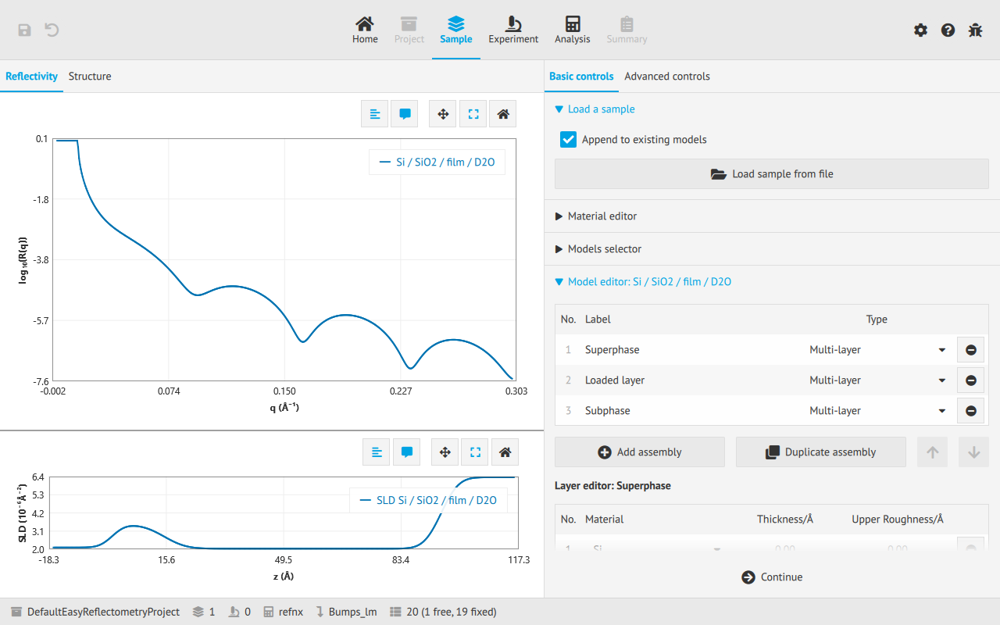
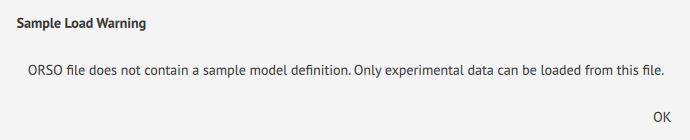
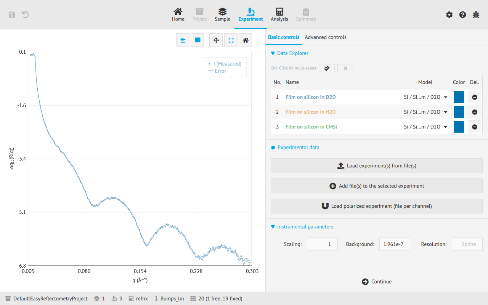

# Demo datasets

The repository has a folder of datasets for trying out the app:
[`examples/datasets`](https://github.com/easyScience/EasyReflectometryApp/tree/master/examples/datasets).
It holds seven simulated ORSO files for the constraint and multiple-contrast features of
[material and model setup](./model_def.md), measured data in `measured/` and simulated
polarised data in `polarized/`. Most of the example projects on the `Project` page are built
from these files. The folder's
[README](https://github.com/easyScience/EasyReflectometryApp/blob/master/examples/datasets/README.md)
gives the full structure of each dataset and a step-by-step demo for it, and
`generate_datasets.py` writes the simulated files again.

## Simulated datasets

Each simulated file was calculated from a known structure, with 4 % noise and a 5 % `dQ/Q`
(FWHM) resolution, so you can compare a fit with the true answer. The file has four columns:
`q`, the reflectivity, its uncertainty and the resolution of each point. The true values
are in the header, in the sample description that starts with `TRUTH:`.

| File | Demonstrates | Example project |
|---|---|---|
| `two_layer_film.ort` | A two-layer film with a known total thickness of exactly 90 Å, for the derived total film thickness and the thickness-budget inequality `t_A + t_B ≤ 90 Å`. | *Two-layer film with a thickness budget* |
| `swapped_layers.ort` | A layer-ordering inequality: a 20 Å layer on top of a 60 Å one. Started with the thicker layer on top, and the thicknesses, SLDs and roughnesses free, a fit without constraints stops in a wrong minimum, with a reduced χ² of about 50. The constraint `Top thickness ≤ Bottom thickness` rules that start out, and from a start in the right order the fit finds the true structure. | none |
| `ni_ti_multilayer.ort` | A `[Ti / Ni] × 8` repeating multilayer with a period of 100 Å. The Bragg peak near `q = 0.063 Å⁻¹` fixes the period, for the **Constant period Λ** and **Conformal roughness** recipes. | *Ni/Ti multilayer* |
| `dppc_monolayer.ort` | A DPPC monolayer at the air/D2O interface, for the surfactant recipes: equal head and tail area per molecule, conformal roughness, solvent roughness. | none |
| `film_contrasts.ort` | A film on silicon measured under three waters (D2O, H2O and CMSi, water contrast-matched to silicon), as three datasets in one file. Use it to try **Add contrast**, pairing experiments with models, a scale per contrast and a joint fit. The tutorial [fitting several contrasts together](./multi_contrast.md) works through it. | *Film in three water contrasts* |
| `dppc_contrasts.ort` | Three contrasts of one DPPC monolayer (d-DPPC on D2O, d-DPPC on air-contrast-matched water, h-DPPC on D2O) in one file. A joint fit separates the hydration of the head groups from their thickness, which no single contrast can do. | none |
| `linked_film_contrasts.ort` | A polymer film on silicon under three waters, one model per contrast. **Link contrasts** ties their structure, and constraints across the contrasts give them one scale and make the CMSi SLD follow the fitted D2O SLD. | *Polymer film, linked contrasts* |

The example projects start from a rough guess, with sensible parameters free and bounded,
so you can fit them as soon as they are loaded. To set a demo up yourself, load the file in
one of two ways.

### Loading the sample from the file

Most of the simulated files also describe their sample in the ORSO model language. On the
`Sample` page, **Load sample from file** in the **Load a sample** group builds the layer
stack from it, with the true thicknesses, roughnesses and SLDs:

The stack has three assemblies: `Superphase`, `Loaded layer` with the layers between, and
`Subphase`. With **Append to existing models** ticked, the default, the sample becomes a new
model next to the existing ones. Untick it to replace all models with the loaded one.

The loaded values are the answer, so change them before fitting, or the fit has nothing to
find. All loaded parameters start fixed except the roughness of the subphase. Tick **Fit**
on the `Analysis` page for the ones you want to refine.

What the file gives you depends on the dataset:

- `film_contrasts.ort` holds three datasets. The sample is built from the first one, the D2O
  contrast.
- `ni_ti_multilayer.ort` loads as a `Repeating Multi-layer` of Ti and Ni with 8 repetitions,
  ready for the period recipes.
- `dppc_monolayer.ort` loads as two plain slabs, `tails` and `heads`, with the SLDs of the
  surfactant. For the surfactant recipes, replace them with a `Surfactant layer` assembly.
- `dppc_contrasts.ort` and `linked_film_contrasts.ort` have no sample model. (The ORSO
  import builds only plain slabs, which cannot describe the solvated DPPC monolayer.) The app
  says so and loads nothing:

Build these samples by hand, as the README describes.

### Loading the data

On the `Experiment` page, **Load experiment(s) from file(s)** loads only the measured
curves, so you can fit them with a sample you built yourself. A file with several datasets
gives one experiment per dataset, named after the dataset's title:

Every new experiment is bound to the model selected at the time. With several contrasts,
choose the right model for each experiment in the `Model` column of the `Data Explorer`.
Each experiment uses the resolution column of its file, shown as `Spline` in
**Instrumental parameters**; see [loading experimental data](./load_data.md).

## Measured data

`measured/` holds three measured datasets, taken from the tutorials of the
easyreflectometry library:

| File | Sample | Instrument | Example project |
|---|---|---|---|
| `polymer_film_platypus.ort` | A polymer film on Si / SiO2, against D2O | Platypus (ANSTO) | *Polymer film on silicon* |
| `dspc_d70_d2o_surf.ort` | A tail-deuterated DSPC monolayer on D2O | SURF (ISIS) | *DSPC monolayer on water* |
| `dspc_contrasts_surf.ort` | A DSPC monolayer in three contrasts (d13 / D2O, d70 / D2O, d83 / ACMW) | SURF (ISIS) | *DSPC monolayer, three contrasts* |

These files have no sample model in the header. Build the sample yourself, or start from the
example project.

## Polarised data

`polarized/` holds the four spin channels of a simulated 200 Å iron film on silicon,
`fe_on_si_uu.dat`, `fe_on_si_ud.dat`, `fe_on_si_du.dat` and `fe_on_si_dd.dat`, one file per
channel. Load them with **Load polarized experiment (file per channel)** on the `Experiment`
page, or open the example *Magnetic iron film, polarized*. See
[polarised data](./polarized_data.md).
