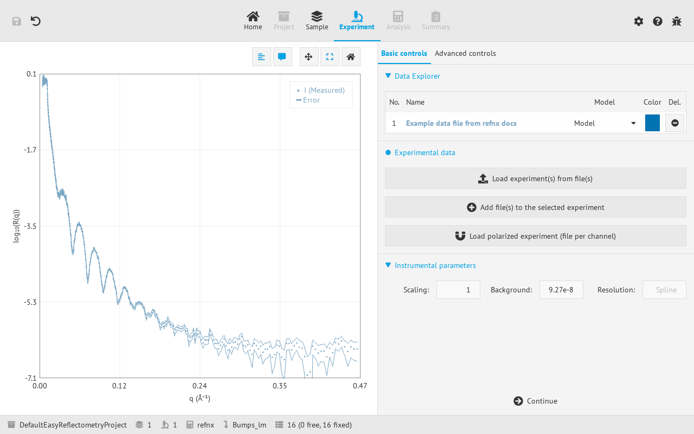
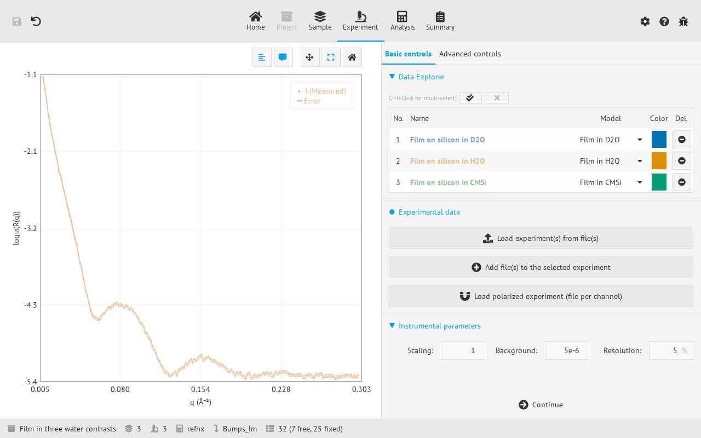
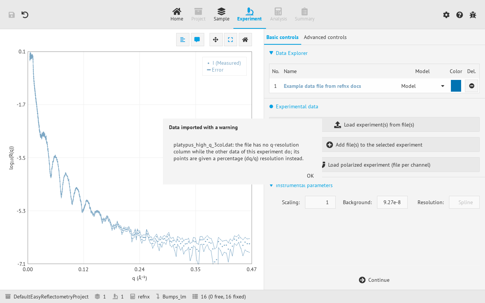

# Loading experimental data

## Load data

EasyReflectometryApp loads experimental data from `.ort` (ORSO), `.dat` and `.txt` files.
A text file needs at least three columns, q, R and the uncertainty of R, and may have a
fourth, the q-resolution of each point. An ORSO file can hold several datasets, for example
one per contrast.

Open the `Experiment` page: press **Continue** on the `Sample` page, or select the page
once a project or an example is loaded. In the `Experimental data` group, press
**Load experiment(s) from file(s)** and pick one or more files.

Here `polymer_film_platypus.ort` from
[`examples/datasets/measured`](https://github.com/easyScience/EasyReflectometryApp/tree/master/examples/datasets/measured)
is loaded:

Each dataset is listed in the `Data Explorer`, with the model it is fitted with in the
`Model` column. The loaded data is drawn in the main window. To read the coordinates of a
measured point, move the cursor near it. The tooltip snaps to the nearest visible point,
so you do not have to hit the marker exactly; the speech-bubble button above the chart
turns it off. The `Plot control` group of the `Advanced controls` changes the axes (a
linear R(q) axis, a logarithmic q axis, R(q)×q⁴) and the markers, see
[simple fitting](./simple_fitting.md).

## Instrumental parameters

Once data is loaded, the `Instrumental parameters` group shows the scale, background and
resolution that apply to it:

- **Scaling**: scale factor applied to the calculated reflectivity.
- **Background**: level at which the data meets the experimental background.
- **Resolution**: instrumental resolution, as a percentage of q (FWHM). It shows `Spline`
  for data with a measured resolution, see below.

These belong to the model the selected experiment is fitted with. With several contrasts,
each experiment has its own model, so selecting another experiment in the `Data Explorer`
shows that experiment's values. Here the H2O contrast of
*Film in three water contrasts* is selected:

The same scale and background are listed in the parameter table of the `Analysis` page,
where they can be fitted.

## Resolution of the data

If a file has a fourth column (`sQz`, the q-resolution of each point), the app keeps that
resolution. The fit, the calculated curve and residuals on the `Analysis` page, the Bayesian
sampling and its band, and the report all smear each dataset with its measured resolution.
This applies to every dataset, including several datasets sharing one model (other angles
or contrasts) and each channel of a polarised experiment.

The **Resolution** field belongs to the model. Its value comes from the first dataset
loaded onto the model, and it shows `Spline`, which cannot be edited, when that dataset has
a measured resolution. The `Sample` page uses the model's resolution for simulations.
Datasets without a resolution column are smeared with the model's percentage, 5 % unless
you change it.

## Several files of one contrast

A contrast is often measured as several curves, one per incident angle or wavelength band.
Load the first file, keep its experiment selected, and press
**Add file(s) to the selected experiment** to merge the other files into it. The points are
sorted by q and each keeps its own resolution, so overlapping q ranges measured with
different widths fit correctly.

If you add a file without a resolution column to measured data, its points get a
percentage resolution (5 % when the model holds a measured resolution), and the app tells
you:

The button is disabled until an experiment is loaded, and for polarised experiments,
because their channels are separate datasets.

## Polarised data

To load a measurement with several spin channels, use the third button,
**Load polarized experiment (file per channel)**. It takes one file per channel and asks
how to assign them. See [polarised data](./polarized_data.md).
