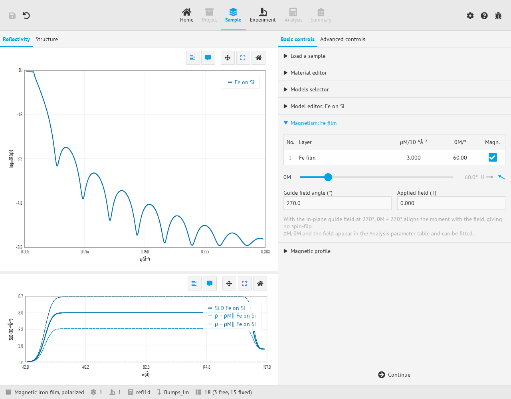
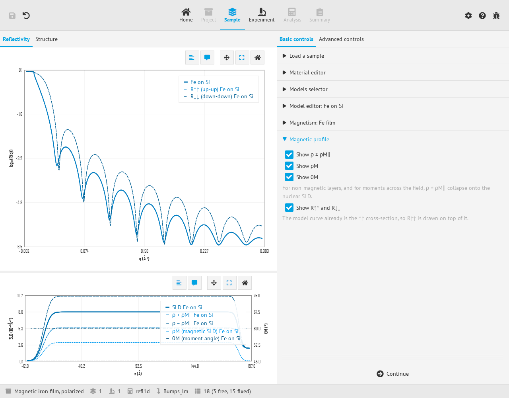
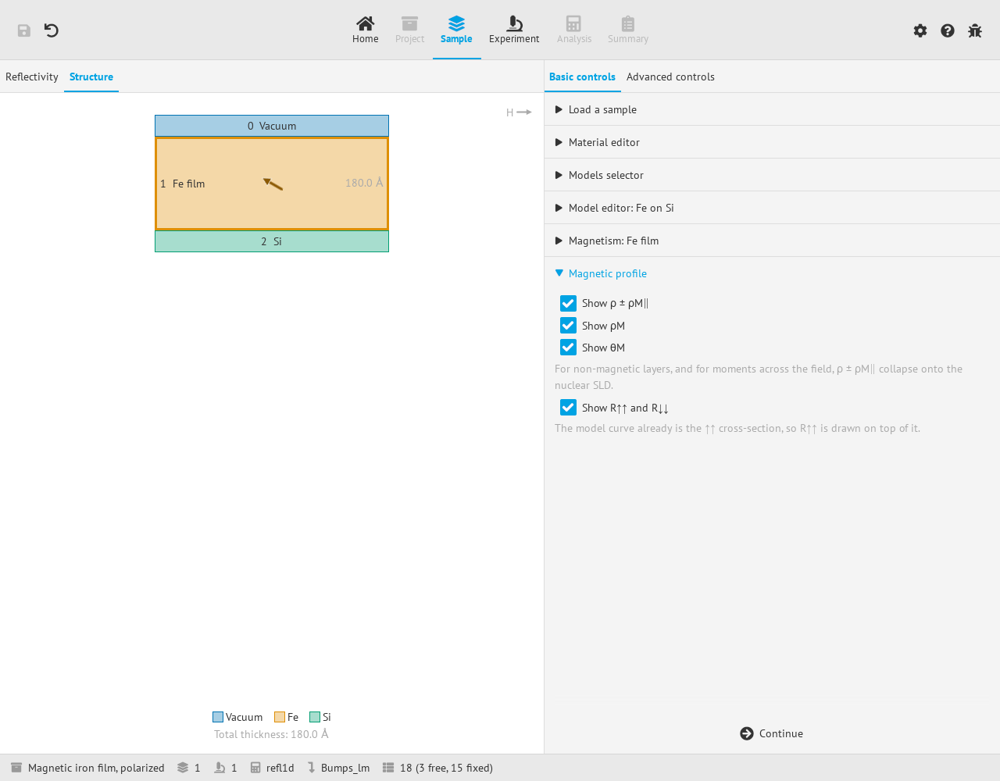

# Magnetic layers

You can give a layer a magnetisation, so that the two neutron spin states see different
scattering length densities. This page covers the controls on the `Sample` page. Loading
and fitting measured spin channels is described in [polarised data](./polarized_data.md).

```{note}
Only `refl1d` can calculate magnetic layers. `refnx` has no magnetism, so the first time you
make a layer magnetic the app asks to switch the project's calculation engine.
```

## Trying it on the iron example

```{tutorial} Magnetic layers
:id: magnetism
:example: FePolarized/project.json
:minutes: 5
:summary: Turn the moment of an iron film, show its magnetic profile and reverse the guide field.
```

```{tutorial-step} The iron film
:id: example
:page: project
:more: magnetism.md#magnetic-layers

The example *Magnetic iron film, polarized* is loaded: an iron film on silicon, with a
magnetic SLD `ρM` of 3 and its moment at `θM` = 60°, canted against the guide field. It is
calculated with `refl1d`, the engine that can model magnetism.
```

```{tutorial-step} Open the Sample page
:id: open-sample
:target: appbar.sampleTab
:done: ui.page == 'sample'
:do: goto sample
:advance: auto
:more: magnetism.md#the-magnetism-group

Open the **Sample** page with its tab in the application bar.
```

```{tutorial-step} Select the iron film
:id: select-film
:page: sample
:target: sample.assemblies
:done: sample.assembly == 'Fe film'
:do: call sample.setCurrentAssemblyIndex 1
:more: magnetism.md#the-magnetism-group

In the **Model editor**, click the *Fe film* row. The **Magnetism** group below always
shows the layers of the assembly selected here.
```

```{tutorial-step} The Magnetism group
:id: magnetism-group
:page: sample
:target: sample.magnetismTable
:more: magnetism.md#the-magnetism-group

The **Magnetism** group has a row for the *Fe* layer. **Magn.** is ticked, so its `ρM`
and `θM` can be edited. In a project calculated with `refnx`, ticking **Magn.** offers to
switch to `refl1d` first.
```

```{tutorial-step} Show the magnetic profile
:id: rho-m-curve
:page: sample
:target: sample.showRhoM
:done: plot.sld_curves.count('rho_m') == 1
:do: call plotting.setSldCurveVisible rho_m true
:more: magnetism.md#magnetic-depth-profiles

In the **Magnetic profile** group, tick **Show ρM**. The SLD chart now also draws the
magnetic SLD of the film. The dashed curves, shown by default, are the nuclear SLD plus
and minus the part of `ρM` along the field.
```

```{tutorial-step} Turn the moment against the field
:id: align
:page: sample
:target: sample.momentAngle
:done: abs(params.value('fe_on_si_fe_film_theta_m') - 90) < 1
:do: call sample.setLayerThetaMAtIndex 0 90
:more: magnetism.md#the-moment-angle-slider

Select the *Fe film* row and drag the slider below the table to 90°, or type `90` as its
`θM`. (The example limits `θM` to 0-90° for its fit; the slider stops there.) With the
guide field at its default 270°, the moment now points straight against the field. That is
collinear again, with no spin-flip scattering, so the dashed curves spread out to the full
`ρM`.
```

```{tutorial-step} See the moment as an arrow
:id: structure
:page: sample
:target: sample.structureTab
:done: ui.sample_view == 'structure'
:do: click sample.structureTab
:more: magnetism.md#which-way-the-moments-point

Open the **Structure** tab. The iron film's box carries an arrow, seen from above the
sample: it points left, against the guide field, whose direction the **H →** reference at
the top right of the view shows. That is `φ = θM − 270° = −180°`.
```

```{tutorial-step} Reverse the guide field
:id: guide-field
:page: sample
:target: sample.guideFieldAngle
:done: abs(params.value('fe_on_si_guide_field_angle') - 90) < 1
:do: call sample.setGuideFieldAngle 90
:more: magnetism.md#the-guide-field

Type `90` as the **Guide field angle**, below the Magnetism table, and press Enter. The
field still lies in the sample plane, but reversed: the **H** reference now points left,
so the moment lies along the field again. The arrows keep their frame; only **H** moves.
```

```{tutorial-step} Fitting the moments
:id: fitting
:page: analysis
:target: analysis.parameterTable
:more: polarized_data.md

On the **Analysis** page, `ρM`, `θM` and the field are in the parameter table like any
other parameter, for example *Fe on Si Fe film theta_m*, and can be fitted. Type `magnetic`
in the name filter to list only those. Fitting them to measured spin channels is the
subject of the polarised data tutorial.
```

## The Magnetism group

The **Magnetism** group is in the basic controls of the `Sample` page, below the
`Model editor`. Its title names the assembly selected in the `Model editor`, for example
`Magnetism: Fe film`, and it has one row per layer of that assembly. Here it shows the
example *Magnetic iron film, polarized*, with the film's row selected:



| Column | Meaning |
|---|---|
| **No.** | Position of the layer in the assembly. |
| **Layer** | Layer name, as in the `Layer editor`. |
| **ρM/10⁻⁶Å⁻²** | Magnetic scattering length density of the layer. |
| **θM/°** | In-plane angle of the magnetic moment. |
| **Magn.** | Makes the layer magnetic. Unticking it removes the magnetisation. |

You can edit `ρM` and `θM` only after ticking **Magn.**

```{note}
With the default in-plane guide field (270°), `θM = 270°` aligns the moment with the
field, which produces no spin-flip scattering. Start from this value for a simple
saturated film.
```

### ρM from a magnetic material

Instead of typing `ρM`, you can take it from the layer's material. **Add magnetic
material** in the `Material editor` creates a material with a formula, a mass density
and a **Moment** in Bohr magnetons per formula unit. The starting values are those of bulk
iron: Fe, 7.874 g/cm³, 2.2 µB. The material editor shows the resulting `ρM` and the number
density `N`: `ρM = N × moment × 2.6991·10⁻⁵ Å`.

Assign that material to a layer, make the layer magnetic, select its row and tick
**ρM from material** below the table. The box is shown only for a layer whose material is a
magnetic material. The layer's `ρM` then follows the material's moment
and density, and you can no longer edit it in the table. `θM` stays with the layer, so two
layers of the same material can point in different directions. Unticking the box keeps the
current value.

The moment is the effective in-plane net moment per formula unit. It equals the moment per
atom only when the formula unit is a single atom, as for Fe (`Fe2` is one element but two
atoms). In the `Analysis` table the moment is greyed out until a layer takes `ρM` from the
material, and when the last such layer stops doing so, the moment is removed from the fit.

If the material's SLD is set directly (**SLD computed from formula and density** unticked),
its density still sets `ρM` for any layer that takes `ρM` from it. The data then constrain
only density × moment, so ticking one of the two for fitting unticks the other. Without
such a layer the density sets nothing and is greyed out as well. Greyed rows are listed only
when the table's variability filter is set to **All parameters**. The default, **Active
parameters**, hides them.

If you constrain a layer's `ρM` on the `Analysis` page, the layer stops taking it from the
material: **ρM from material** is unticked, and the constraint stays when the layer's
material changes.

### The guide field

**Guide field angle** and **Applied field (T)**, below the table, set the field of the
current model (refl1d's `Aguide` and `H`). They are visible while the current model has a
magnetic layer and the engine is `refl1d`.

| Guide field angle | Field direction |
|---|---|
| 270° or −90° (default) | in the sample plane |
| 90° | in the sample plane, reversed |
| 0° or 180° | along the surface normal |
| anything else | tilted out of the sample plane |

The applied field adds a Zeeman term along the field, so its effect depends on the field
strength and on its direction relative to the moments. Both values appear in the
`Analysis` parameter table, named after the model, and can be fitted. They are shown only
while the model is magnetic and the engine is `refl1d`; otherwise they are removed from the
fit. The ORSO model language has no field, so model export warns you when the field is not
the default.

### Magnetic samples from ORSO files

**Load sample from file** reads the `magnetic_moment` of an ORSO model. A material with a formula, a
density and a moment becomes a magnetic material, and its layer becomes magnetic with
**ρM from material** ticked and `θM = 270°`, because the file has no direction. Anything the
import could not carry over (a moment without a density, an unknown unit, an ignored
`relative_density`, magnetic layers in a repeated stack) is listed in a warning after the
sample loads. If the current engine cannot model magnetism, the app refuses to load a
magnetic sample, names the engine to switch to, and leaves the project as it was.

### The moment angle slider

When you select a magnetic row, a slider appears below the table. It spans the full
`0-360°` range of `θM`, with the guide field reference **H →** and the resulting arrow next
to it. This is the same arrow the [Structure tab](#moment-arrows-on-the-structure-tab)
draws. The tooltip gives the angle both ways: `φ` measured from **H**, and the `θM` that the
table edits.

Dragging the slider sets `θM` in 5° steps. For an exact value, type it in the text field.
The slider is read-only while a fit is running or when `θM` follows a constraint, and its
tooltip says so.

The slider edits `θM` directly, just like the table column. The arrow next to it shows `φ`,
the direction the moment actually points. With a negative `ρM` the arrow therefore points
opposite to the angle on the slider: the moment is reversed, but the parameter keeps its
value.

### Switching the calculation engine

If the project uses an engine that cannot model magnetism, ticking **Magn.** opens the
**Switch calculation engine?** dialog. Accepting it makes the layer magnetic and switches
the project to `refl1d` in one step, without leaving the page.

Switching recalculates the reflectivity and marks any existing fit result as stale. The
sample and the loaded data are not changed. You can switch the engine back once no layer is
magnetic.

The engine selector is in the **Calculation engine** group of the advanced controls on the
`Sample` page, and in `Analysis` › `Extra controls` (see [simple fitting](./simple_fitting.md)).
While the sample has magnetic layers, the app refuses an engine that cannot model magnetism
and shows a message on both pages.

## Fitting ρM and θM

`ρM` and `θM` appear in the `Analysis` parameter table like any other layer parameter,
named after their model and assembly, for example `Fe on Si Fe film rho_m` in the
iron example. They have default
limits and a fit checkbox, and you can use them in constraints. Type `magnetic` in the
parameter name filter to show only the magnetic parameters: `ρM`, `θM`, the material
moments and the field.

## Magnetic depth profiles

Once at least one layer is magnetic, the **Magnetic profile** group appears in the basic
controls, below **Magnetism**. The same switches are also in `Analysis` › `Extra controls` ›
`Plot control`, and both places share one selection. With every switch on, the iron example
looks like this:



- **Show ρ ± ρM∥** (on by default): adds the nuclear SLD plus and minus the magnetic SLD along the field to
  the SLD chart for each magnetic model, dashed in the model's colour. These curves are the
  potentials of the two spin states only when every moment is parallel to the field and no
  field is applied. A moment across the field mixes the spin states instead. For
  non-magnetic layers and for moments across the field, both curves fall onto the nuclear
  SLD.
- **Show ρM**: the magnetic SLD profile alone.
- **Show θM**: the in-plane moment angle, on its own right-hand axis. `θM` is defined only
  where there is a moment, so the curve is drawn in pieces and not joined across the gaps.
- **Show R↑↑ and R↓↓**: splits each magnetic model's reflectivity into its two
  non-spin-flip cross-sections on the `Sample` page reflectivity chart, dashed in the
  model's colour with their own legend rows. Off by default.

The y-range of the SLD chart covers every visible curve and grows when you switch a curve
on, so `ρ + ρM` is never clipped. If no model is magnetic, the chart, its legend and the
sidebar look as before.

```{note}
The `refl1d` calculator cannot repeat slabs that carry magnetism. The app therefore refuses
to make a layer of a repeating multilayer magnetic while its repetitions are above 1, and to
raise the repetitions of one that holds a magnetic layer; the **Magnetism** group says why.
Build such a structure as layers of a `Multi-layer` instead. A repeating multilayer with
1 repetition is plain slabs and can be magnetic.
```

```{note}
For a magnetic sample the plain model curve is not an unpolarised average. The calculator
returns the ↑↑ cross-section, so `R↑↑` is drawn on top of it. The sidebar notes this too.
```

This switch does not affect the `Analysis` reflectivity chart, which already draws one
calculated curve per measured spin channel for a polarised experiment.

## Which way the moments point

A column of `θM` values does not show at a glance whether a model is collinear, canted or
twisted, so the app also draws each moment as an arrow. All views use the same convention:

- The arrows are a top view along the surface normal, like a compass laid over the sample.
- Screen right is the default guide field H (in the sample plane at 270°). The angle drawn
  is `φ`, measured counterclockwise from it: `φ = θM − 270°`. The arrows keep this frame
  when you change the field. The **H** reference moves instead: it points left for a
  reversed in-plane field, and is replaced by its angle when the field is tilted out of the
  sample plane.
- A negative `ρM` is the same moment reversed, so the arrow points the opposite way and the
  tooltip shows the signed parameter.
- A magnetic layer whose `ρM` is below 1 % of the largest in the model gets a hollow dot,
  meaning magnetic but with no moment, since a zero-length vector has no direction. A layer
  with no magnetism gets no mark.

| `θM` | Arrow | Physics |
|---|---|---|
| 270° (default) | → along **H** | collinear, no spin flip |
| 90° | ← against **H** | collinear reversed, no spin flip |
| 0° / 180° | ↑ / ↓ | fully transverse, maximal spin flip |
| 40° | ↖ (`φ` = 130°) | canted |

Every arrow view shows the **H** reference. Tooltips give `φ` first, then the `θM` and
signed `ρM` that the sidebar edits, then the component of the moment along the field and
the size of the component across it. These are roughly what the non-spin-flip and
spin-flip channels see.

All arrows have the same length and show direction only. The `ρM` curve shows the
magnitude, and the tooltip gives the exact value.

(moment-arrows-on-the-structure-tab)=
### On the Structure tab

Each magnetic layer's box gets an arrow between its name and its thickness label. There is
no switch for this: the arrow appears as soon as a layer is magnetic. Boxes too short for a
readable arrow leave it out and show the direction in the tooltip. A non-magnetic sample's
box layout is unchanged.



The Structure tab draws the current model; switch models in the header to look at another
one. When the tab collapses a repeating multilayer to its repeat unit, it shows one arrow
per drawn box, giving the direction of the repeat unit that every repeat shares.

Gradient layers get no arrow. A gradient has no single moment, and one representative
arrow would mislead when its slices point in opposite directions. For graded structures,
use the `ρM(z)` and `θM(z)` curves.
