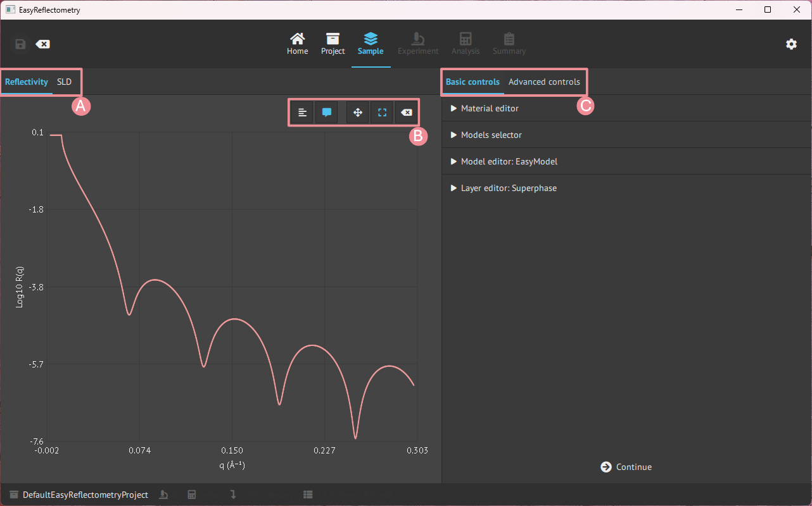
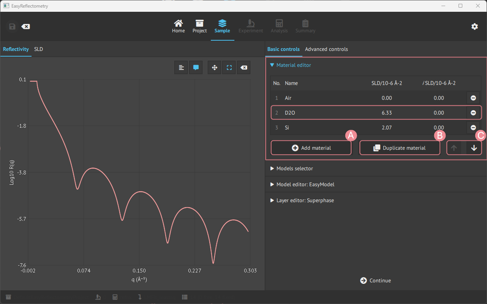
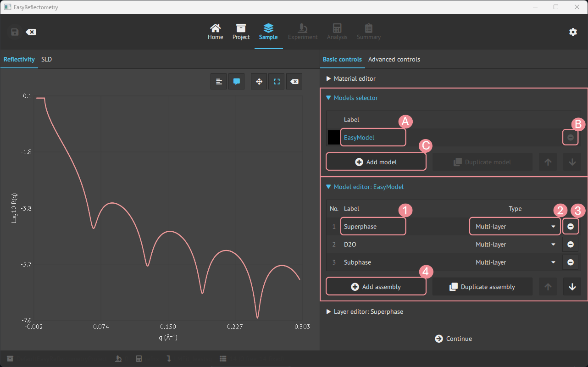
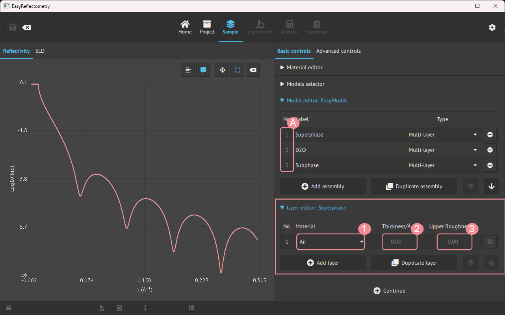
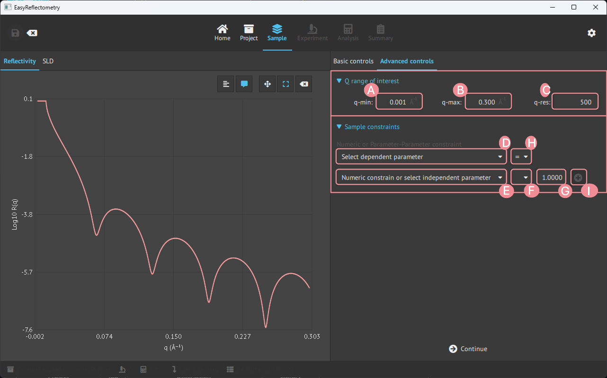

# Material and model setup
When a project is initialised it is then possible to define material and set the model.  

Let us first look at the general layout of the `Model` page, which is split up into two parts, the main window showing the graphs and the sidebar being the control panel for variables and data.



- **A**: Graph change between the Reflectivity- and Scattering Length Density (SLD) curve.
- **B**: Graph control of ledger, visible coordinates on hower, zoom and pan control, and reset.
- **C**: Basic controls, for defining material and model, and advanced controls for further setting parameters.

## Basic controls
### Material editor
To construct a model in the app, first, you add the materials that will compose the layers in `Material Editor`.  
The materials are added by the real and imaginary components of the scattering length density (in units of 10<sup>-6</sup>Å<sup>-2</sup>) and given a name for the material.  



- **A**: For adding more material.
- **B**: Duplicating the last clicked material.
- **C**: Changes the ordering of materials.

### Density materials
A material can also be defined by its **chemical formula and mass density** instead of a
numeric SLD. Such *density materials* enter a project when a sample is loaded from an ORSO
model that defines a material this way (`Load a sample`), and they are marked with a **ρ**
badge next to their row number in the Material editor table.

Selecting a ρ row reveals a detail panel below the table with the material's chemical
formula, its mass density (in g/cm³) and the checkbox **SLD computed from formula and
density**:

<!-- TODO: screenshot of the density material panel -> _images/sample_material_density.png -->

- **Checked** (the default): the SLD is physics, not an input - it is computed as
  `SLD = Nᴀ · ρ · b / M` from the density ρ, the formula's coherent neutron scattering
  length *b* and molecular weight *M*. The SLD/iSLD cells in the table are therefore
  read-only, and on the `Analysis` page the material's `sld`/`isld` parameters are shown
  greyed as dependent while **`density` is the parameter to fit**. Editing the formula
  updates the scattering length and molecular weight (an invalid formula is rejected and
  the field snaps back).
- **Unchecked**: `sld`/`isld` become ordinary independent parameters - editable here and
  fittable on the `Analysis` page exactly like a plain material's (they arrive fixed, so
  tick their `Fit` box). The `density` and scattering-length rows are greyed with the
  note `unused (SLD is fitted directly)`, because they no longer affect the
  reflectivity - they cannot be fitted or edited until the box is checked again.

The molecular weight never appears in the `Analysis` table: it is a constant of the
chemical formula (recomputed whenever the formula is edited), not a fittable parameter -
fitting it alongside density would be degenerate, since only their ratio enters the SLD.

```{warning}
Re-checking the box restores the coupling by **recalculating** SLD/iSLD from the current
formula and density - manually entered or fitted SLD values are discarded.
```

The choice is per material and is saved with the project; projects saved before this
feature load with the coupling enabled. Note that toggling the coupling is not undoable.
If you add a constraint on `sld`/`isld` while unchecked and then re-check the box, that
constraint is silently discarded - re-checking always recomputes SLD/iSLD from the
formula and density. The `Active Constraints` table refreshes after a toggle, but it does
not flag rows that the toggle invalidated, so review it yourself after switching modes.

### Model creation and editing
For creating new models, the `Models selector` tab is used, and then for setting the assemblies in the model the `Model editor` is used.  



- **A**: Renaming model.
- **B**: Removing the specific model.
- **C**: Adding more models.
- **1**: Renaming/naming the assembly.
- **2**: Setting the type of assembly; Multilayer, Repeating Multilayer or Surfactant layer.
- **3**: Removing the specific assembly.
- **4**: Adding more asseblies.

### Contrasts
A *contrast* is the same sample measured under another scattering length density
condition: the film in D2O and in H2O, or a monolayer with deuterated and with
hydrogenated tails. Each contrast is a model of its own, with its own scale,
background and resolution, while the structure is common to all of them. Fitted
together, the contrasts determine what no single one of them can.

To create one, select the reference model in the `Models selector` and press
**Add contrast of the selected model…**. The dialog asks for the new model's name and
lists what the contrast can change:

<!-- TODO: screenshot of the Add contrast dialog -> _images/sample_add_contrast.png -->

- every material the model uses, with a drop-down to **replace** it by another material
  from the `Material editor` (`keep` leaves it as it is). Add the replacement material,
  e.g. `H2O`, to the `Material editor` first. Replacing a material replaces it
  everywhere the model uses it: a water used both as the subphase and as the solvent of
  a hydrated head group changes in both places;
- every layer or density material defined by a chemical formula, with its formula to
  **re-formulate** it, e.g. `C32H64` instead of `C32D64` for hydrogenated tails. The
  material a surfactant layer builds from its formula is changed this way, not
  replaced.

Press **OK**: the new model is added and becomes the selected one, so select the
reference again before adding the next contrast.

What the contrast does not change is shared with the reference:

- an assembly that none of the replaced materials or formulas touch is **one assembly**
  in both models. It is marked **⇄** next to its number in the `Model editor` (the
  tooltip names the other models), and editing it edits every model sharing it;
- an assembly that a replacement touches is **copied**, and every parameter of the copy
  follows the reference's, except those of the replacement. A subphase in H2O keeps
  the roughness of the D2O one; a hydrated head group keeps the thickness, area per
  molecule and solvent fraction of the reference. Edit these in the reference model.

On the `Analysis` page a parameter shared by several models is listed once, marked
**⇄**, with the models in its tooltip. To let it differ in one contrast, select it and
use **Detach in** below the table: that model gets its own copy of the assembly, with
every other parameter still following the shared one.

Pair each experiment with its contrast in the `Model` column of the experiments table,
on the `Experiment` or the `Analysis` page. On the `Analysis` page, the **Fit** checkbox
of each experiment chooses which contrasts the next fit includes. Which model each contrast was derived from is saved with the project and
listed in the report.

### Layer editor
Then for editing the assemblies in the model, the `Layer editor` is used.  
By clicking an assembly, the `Layer editor` is specified and changes can be made to that assembly.



- **A**: Pick the desired assembly to modify.
- **1**: Choose a material from materials in the `Material Editor`.
- **2**+**3**: Setting the Thickness and Upper Roughness of the material in Angstrom, Å.

### Magnetism
A layer can also be given a magnetisation, in the `Magnetism` group below the layer editor.
This needs the `refl1d` calculation engine and is described in
[magnetic layers](./magnetism.md).

## Structure view
The main window has a **Structure** tab next to **Reflectivity** showing a schematic of
the current model's layer stack: one colored box per layer, ambient medium on top, substrate
at the bottom. Boxes share a color per material (see the legend), box heights follow layer
thickness, and repeated multilayers with many repetitions are drawn once with a "× N" badge.

<!-- TODO: screenshot of the Structure tab -> _images/sample_structure.png -->

Hover a box for its material, SLD, thickness and roughness; click it to select that layer in
the sidebar editor. The view updates immediately when the model changes, including after a fit.

Note the view is a schematic, not a to-scale cross-section: heights are clamped so very thin
layers stay visible and very thick ones do not crowd out the rest.

## Advanced controls
In the advanced controls, it is possible to apply a specific Q-range of interest, to choose
the calculation engine, and to constrain the parameters of the model.



- **A**: Setting min. Q value of interest.
- **B**: Setting max. Q value of interest.
- **C**: Setting Q-resolution.

The **Calculation engine** group selects between `refnx` and `refl1d` for this project. The
same selector is available on the `Analysis` page. Only `refl1d` can model magnetic layers,
so selecting `refnx` while the sample has magnetic layers is refused - see
[magnetic layers](./magnetism.md).

Below these sit three constraint groups, from the most specific to the most general:
`Physics constraints`, `Single constraints` and `Link contrasts`.

All constraints are saved with the project. The groups are disabled while a fit is
running.

### Physics constraints
The `Physics constraints` group applies physically motivated constraints to an assembly with
one click. The list is per assembly of the current model, and only shows the recipes that
make sense for that assembly type; a recipe that cannot be applied right now is marked
`n/a` with the reason, and one that is always in force is marked `always on`.

<!-- TODO: screenshot of the Physics constraints group -> _images/sample_physics_constraints.png -->

| Recipe | Effect |
|---|---|
| **Conformal roughness** | Every interface of the assembly shares the roughness of its first layer. |
| **Conformal thickness** | Every layer of the assembly shares the thickness of its first layer. |
| **Constant period Λ** | The summed thickness of the layers stays constant: the last layer absorbs whatever the others change by. |
| **Equal head/tail area per molecule** | The head layer takes the area per molecule of the tail layer (surfactant layers). |
| **Symmetric head groups** | The back head layer follows the front head layer thickness and area per molecule (bilayers). |
| **Solvent roughness follows the surfactant** | The roughness of the first layer below the surfactant follows the tail roughness. Needs **Conformal roughness**. |
| **Mixture fractions sum to 1** | Material mixtures and solvated materials keep their fractions normalised. Always on, not toggleable. |

Each active recipe appears as a single row in the `Active Constraints` table of the
`Single constraints` group, of type `physics`, counting the parameters it ties together.

### Single constraints
The `Single constraints` group creates numeric or symbolic relationships between individual
parameters.

<!-- TODO: screenshot of the Single constraints group -> _images/sample_constraints.png -->

1. Pick the **dependent parameter** from the drop-down.
2. Pick the relation: `=`, `≤` or `≥`.
3. Type the **expression**, for example `2 * model_d2o_roughness`. Parameters are referred
   to by their alias: the display name in lower case, with underscores, such as
   `model_d2o_thickness` for `Model D2O thickness`. Use **Insert parameter alias…** to
   paste the alias of another parameter rather than typing it, and **Insert total film
   thickness** to use the read-only sum of all layer thicknesses between superphase and
   subphase.
4. Check the **Preview** line, which shows how the constraint will read - and, for an
   inequality, that numeric literals are interpreted in the dependent parameter's unit.
5. Press **Add constraint**.

`=` ties the parameter to the expression, so it is no longer free. `≤` and `≥` against other
parameters become **inequality constraints**, which are enforced as penalties during
fitting.

What an `=` expression can contain:

- `+`, `-`, `*`, `/` and `**` between parameters, e.g.
  `model_film_thickness + model_sio2_thickness`. The expression must have the unit of the
  dependent parameter: a thickness can be set to a sum of thicknesses but not to an SLD.
- Plain numbers, which have no unit. They can scale a parameter
  (`0.5 * model_film_thickness`) but cannot be added to one that has a unit:
  `model_film_thickness / 2 + 4` is refused for a thickness, because 4 is not a length.
  This differs from `≤` and `≥`, where numbers are read in the dependent parameter's unit.
- The constants `pi` and `e`, and functions such as `sqrt` and `exp` applied to numbers,
  e.g. `sqrt(2) * model_d2o_roughness`.

```{note}
Mathematical functions of a parameter, such as `sqrt(model_film_thickness)` or
`exp(1 / model_film_thickness)`, are not supported yet. Write `sqrt`, `exp` and `pi`
without a `np.` or `math.` prefix: with a prefix, an expression that refers to a parameter
passes the preview but is not added.
```

```{warning}
Inequality constraints need a BUMPS minimizer (`Analysis` › `Minimization method`). With
`lmfit` or `DFO-LS` selected the group shows a warning and fits are refused until the
minimizer is changed or the inequality is removed. A warning also appears when the current
parameter values violate an inequality, and again fits will not start until they hold.
```

Existing constraints are listed in the `Active Constraints` table, with columns `No.`,
`Type`, `Parameter` and `Expression`. The `Type` column tells the kinds apart - `expr` for a
plain equality, `≤ ≥` for an inequality, `physics` for a recipe from the group above,
`link` for a model link from the group below, `bound` for an upper bound and `value` for a
fixed value - and each row can be removed individually. Hover the `Type` of a `physics` or
`link` row to see which parameters it ties.

### Link contrasts
The `Link contrasts` group ties whole models together rather than single parameters. It
is for contrasts that already exist as separate models: built by hand, loaded from
separate files, or kept from a project saved before **Add contrast** existed. For a new
contrast, **Add contrast of the selected model…** (see *Contrasts* above) is simpler:
it shares the structure from the start.

<!-- TODO: screenshot of the Link contrasts group -> _images/sample_link_contrasts.png -->

1. Tick two or more models in the table. One of them is the **reference**, marked
   `(reference)` in the table; the others follow it. By default it is the ticked model
   highest in the list; pick another one in **Reference model**.
2. Leave **Also tie material SLDs and densities** unticked when the models are contrasts,
   i.e. differ in their materials. Ticked, it ticks every material's SLD, density and
   scattering lengths in the preview too, including the water that makes the contrast.
3. Check the preview table, **Parameters to tie (n of m ticked)**. It lists every
   parameter of the following models that can be tied, ticked if it will be. Untick the
   ones that should stay free in the following model; tick a single material row to tie
   only that material. **Tick all** and **Untick all** set every row at once, and
   **Show the parameters that cannot be tied** adds the rows linking leaves alone, with
   the reason in the `Note` column (see the list below).
4. Press **Link selected models**. The line below the button reports how many
   parameters were tied, and lists any it could not tie, with the reason.

The preview follows the project: it is updated when you change the ticked models, the
reference or the materials checkbox, and when constraints change elsewhere. After linking,
the tied rows move to the parameters that cannot be tied, as "already follows the
reference"; the ones you left unticked can still be ticked and linked later. Your ticks are
kept while the preview is updated, except that the materials checkbox resets the material
rows. Adding, removing or renaming a model clears the selection.

Parameters are matched by their position in the model, so linking needs the models to
have the same layout: the same assemblies with the same layers, and, layer by layer,
materials of the same kind (a density material and a plain-SLD material do not match).
Models that do not match are reported, e.g.
`'Film in CMSi' and 'Film in D2O' differ in layout at sample/2/layers/0/material/density`,
and nothing is tied. When several models are ticked, either all of them are linked or,
if one cannot be, none.

What linking ties by default, and what it leaves alone:

- each model keeps its own **scale** and **background** (`per contrast`);
- thicknesses, roughnesses and the other structural parameters of corresponding layers
  are tied, unless unticked in the preview;
- the superphase thickness and roughness and the subphase thickness play no part in the
  calculation and are not tied (`not used`);
- a material both models use is already one set of parameters and needs no tie. A
  material is shared only when both models' layers use the same entry of the
  `Material editor`. A model made with the duplicate button has its own copies of the
  materials, under the same names: to share the film SLD with the reference, pick its
  layers' materials again in the `Layer editor`;
- a material that differs between the models (the water) keeps its own SLD
  (`material chemistry`), unless its row is ticked;
- a parameter that already follows the reference's is left as it is; one that follows
  any other parameter is not re-tied, and is listed.

Each link is one row of the `Model links` table, e.g.
`Film in CMSi → Film in D2O (5 tied)`, and one row of type `link` in the
`Active Constraints` table. Select a link to see its parameters in **Tied parameters of
link n**:

- the remove button next to a parameter unties only that one; the rest of the link stays;
- the remove button on the link row (in either table) removes the whole link.

A parameter that is untied gets back the value and bounds it had before the link. Links are
saved with the project. Linking the same models again, e.g. for a parameter left unticked
the first time, adds a second link row.

### Trying the constraints out
Four simulated datasets with a known ground truth are provided for exercising these
features - see [demo datasets](./datasets.md).
