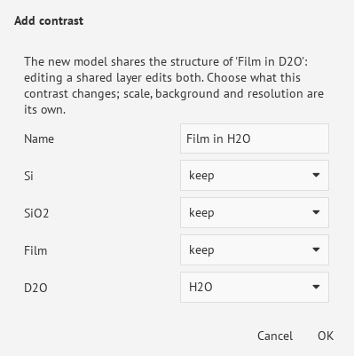
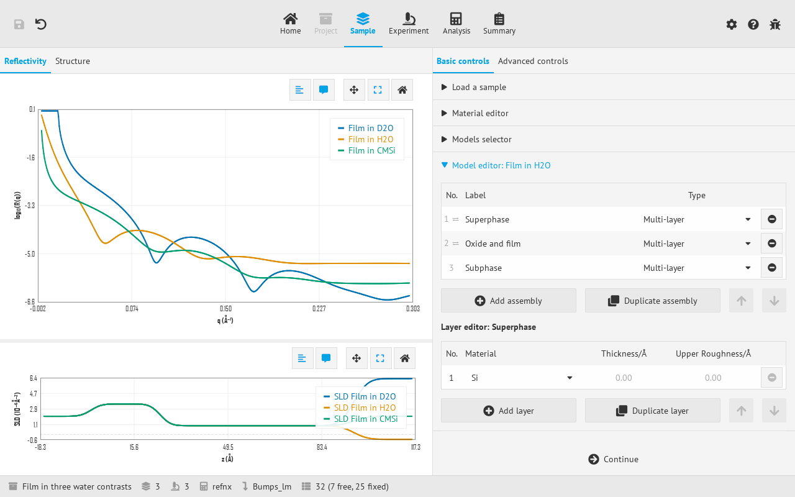
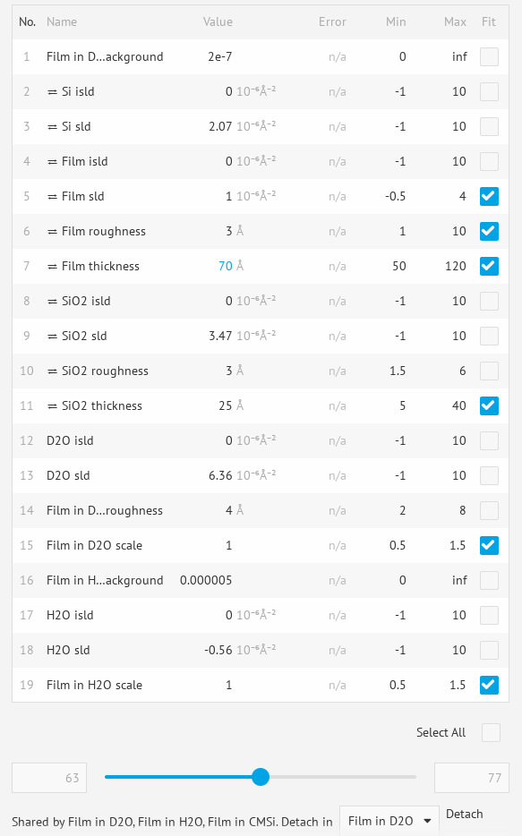
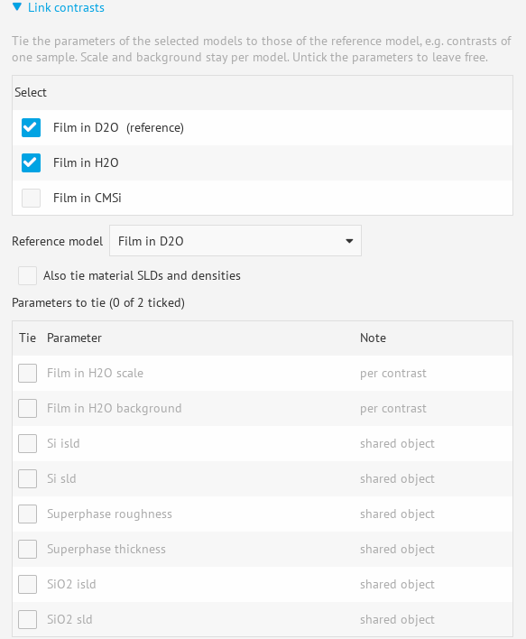
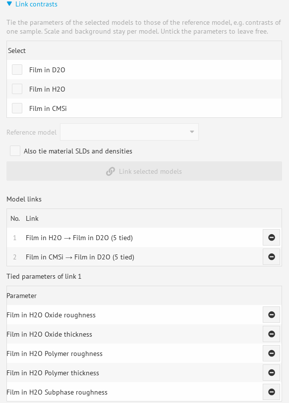
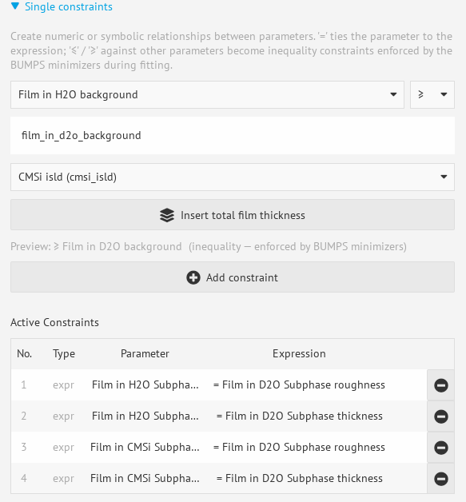
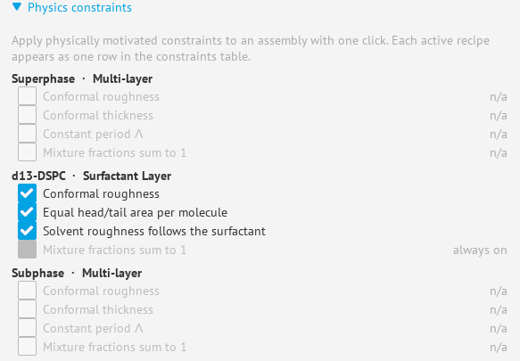

# Fitting several contrasts together

A single reflectivity curve often cannot tell apart two structures that differ in more than
one way: a thicker layer with less solvent can give much the same curve as a thinner one
with more. Measuring the same sample in several *contrasts* (other waters, or deuterated
and hydrogenated molecules) and fitting all of them with one structure removes much of
that ambiguity.

This tutorial works through three projects in turn:

- *Film in three water contrasts*: a film on silicon under D2O, H2O and silicon-matched
  water. You build it from scratch, from the data file to the fit, and use it to see what
  linking does to models that already share their structure.
- *Polymer film, linked contrasts*: the same kind of film, built as separate models. You
  load it as an example to see links between models and constraints between contrasts.
- *DSPC monolayer, three contrasts*: a lipid monolayer on water where the contrasts change
  the deuteration of the molecule as well as the water. You load it as an example and look
  at how it is put together.

[Material and model setup](./model_def.md) describes each control in more detail.

## The film in three waters

The data file is `film_contrasts.ort` in
[`examples/datasets`](https://github.com/easyScience/EasyReflectometryApp/tree/master/examples/datasets).
It holds three simulated datasets of the same film:

| Layer | Material (SLD / 10⁻⁶ Å⁻²) | True value |
|---|---|---|
| substrate (beam side) | Si (2.07) | |
| oxide | SiO2 (3.47) | 15 Å, roughness 3 Å |
| film | Film (2.0) | 80 Å, roughness 5 Å |
| subphase | D2O (6.36), H2O (−0.56) or CMSi (2.07) | roughness 4 Å |

CMSi is water mixed to match the SLD of silicon, so the substrate disappears in that
contrast. The three datasets were simulated with scales 1.00, 0.95 and 1.00 and backgrounds
2·10⁻⁷, 5·10⁻⁶ and 1·10⁻⁶ (D2O, H2O, CMSi).

### 1. Build one model

Build the model for one contrast first. It will be the *reference* for the other contrasts.

1. Open the `Sample` page. In **Load a sample**, untick **Append to existing models** and
   press **Load sample from file**. Pick `film_contrasts.ort`. The app builds the D2O
   contrast from the file header: Si | SiO2 | Film | D2O, with the oxide and the film in
   one assembly called `Loaded layer`.
2. In the `Models selector`, rename the model to `Film in D2O`.
3. In the `Model editor`, rename the assembly `Loaded layer` to `Oxide and film`. This is
   optional, but it is the name used in the rest of this tutorial, in its screenshots and
   in the finished example.
4. In the `Material editor`, press **Add material** twice and make the two other waters:
   `H2O` with SLD −0.56 and `CMSi` with SLD 2.07.

A hand-built model works too. The steps below only need a model whose water is a separate
material in the `Material editor`.

### 2. Make the other contrasts with Add contrast

1. Select `Film in D2O` in the `Models selector` and press
   **Add contrast of the selected model…**.
2. Name the new model `Film in H2O`. Leave every material at `keep` except D2O, which you
   replace with `H2O`. Press **OK**.

   

3. The new model is now the selected one. Select `Film in D2O` again and repeat for
   `Film in CMSi`, replacing D2O with `CMSi`.

The reflectivity chart now shows three curves.

An assembly that does not contain the replaced material is the same in all three models.
Its number in the `Model editor` is marked **⇄**, and its tooltip names the other
models:



Here the substrate and `Oxide and film` are shared. They are one set of
parameters, so `Film in H2O` and `Film in D2O` have a single film thickness between them,
and editing it in any model changes all three. The materials Si, SiO2 and Film are
shared the same way.

The subphase holds the replaced water, so each contrast gets its own copy of it. The copy's
other parameters still follow the reference: the subphase roughness of `Film in H2O` is
tied to that of `Film in D2O`. These ties are listed in the `Active Constraints` table
(`Advanced controls` › `Single constraints`) as rows of type `expr`, such as
`Film in H2O Subphase roughness = Film in D2O Subphase roughness`. Edit them in the
reference model.

Scale, background and resolution are never shared. Each contrast has its own.

### 3. Load the data and pair it with the models

1. On the `Experiment` page, press **Load experiment(s) from file(s)** and pick
   `film_contrasts.ort` again. The file holds three datasets, so you get three experiments:
   `Film on silicon in D2O`, `… in H2O` and `… in CMSi`.
2. All three start paired with the model that was selected when you loaded them. In the
   `Model` column of the `Data Explorer`, give each experiment its own model: D2O with
   `Film in D2O`, H2O with `Film in H2O`, CMSi with `Film in CMSi`.

A wrong pairing gives a bad fit with no error message, so check this column whenever a
multi-contrast fit looks wrong.

### 4. Fit the three contrasts together

On the `Analysis` page, a shared parameter is one row, however many models use it. It is
marked **⇄** and has no model name in front of it. Scale, background and the subphase
are listed once per model.



1. Tick **Fit** for exactly these parameters: `SiO2 thickness`, `Film thickness`,
   `Film sld`, `Film roughness`, and the scale of each of the three models. Untick
   everything else.

   ```{note}
   A material made with **Add material** starts with its `sld` and `isld` ticked for
   fitting. Untick them for `H2O` and `CMSi`: the water SLDs are known, and fitting
   them too lets the scales drift.
   ```

2. Set the backgrounds to 2e-7 (`Film in D2O`), 5e-6 (`Film in H2O`) and 1e-6
   (`Film in CMSi`) and keep them fixed. They are known here because the data are
   simulated. With measured data you would fit them; with the default minimizer, freeing
   all three gives the same result for this dataset.
3. Move the structure away from the answer, so the fit has something to find: oxide
   25 Å, film 70 Å, film SLD 1.0, film roughness 3 Å.
4. Leave **Fit** ticked for all three experiments in the `Data Explorer` and press
   **Start fitting**.

The fit should return an oxide of 15.2 Å, a film of 80.0 Å with SLD 2.00 and roughness
5.0 Å, and scales of about 0.99, 0.95 and 0.98. The reduced χ² of the joint fit is
about 0.89, and each dataset's χ² per point is between 0.83 and 0.92.

The **Fit** checkboxes in the `Data Explorer` choose which contrasts the next fit uses.
Untick two of them to fit one contrast alone and compare the uncertainties in the `Error`
column. The CMSi contrast alone, in which the substrate is invisible, gives a film
roughness of 4.2 ± 1.1 Å and a thickness of 79.7 ± 1.3 Å. The three together give
5.04 ± 0.09 Å and 79.99 ± 0.07 Å.

The example *Film in three water contrasts* on the `Project` page is this project,
ready to fit from the same starting guess.

### 5. Let one parameter differ in one contrast

Sometimes a shared parameter should not be shared everywhere. For example, the film
roughness could differ in one water. To free one parameter in one model:

1. On the `Analysis` page, select the parameter in the table, e.g. `Film roughness`.
2. Below the table, the line **Shared by Film in D2O, Film in H2O, Film in CMSi. Detach in**
   offers the models. Pick `Film in CMSi` and press **Detach**.

`Film in CMSi` now has its own copy of `Oxide and film`. Its film roughness is
a parameter of its own, listed as `Film in CMSi Film roughness`. Every other parameter of
the copy (film thickness, oxide thickness and roughness) still follows the shared one, as
`expr` rows in the `Active Constraints` table. `Film in D2O` and `Film in H2O` still
share the original assembly.

Detaching works for layer parameters (thickness, roughness, and the like). A material SLD
belongs to the material in the `Material editor`, so it cannot be detached. To give one
contrast a different SLD, give that contrast a different material, for example with the
replacement in **Add contrast**.

### The same in the app, step by step

```{tutorial} Fitting several contrasts
:id: multi-contrast
:data: film_contrasts.ort
:minutes: 15
:summary: Build a film model from a data file, make two more water contrasts and fit all three together.
```

```{tutorial-step} Three waters, one film
:id: intro
:page: project
:more: multi_contrast.md#the-film-in-three-waters

This tutorial starts from an empty project. You will build the model of a film on silicon in
D₂O from a data file, make two more contrasts of it in H₂O and in silicon-matched water
(CMSi), load the three measurements and fit them together with one structure.
```

```{tutorial-step} Open the Sample page
:id: open-sample
:target: appbar.sampleTab
:done: ui.page == 'sample'
:do: goto sample
:advance: auto
:more: multi_contrast.md#build-one-model

Open the **Sample** page with its tab in the application bar.
```

```{tutorial-step} Load the model from the data file
:id: load-sample
:page: sample
:sidebar-tab: basic
:target: sample.loadSample
:done: models.count == 1 and sample.material_slds.get('SiO2', 0) > 3
:do: call project.sampleLoad "{data}/film_contrasts.ort" false
:more: multi_contrast.md#build-one-model

In **Load a sample**, untick **Append to existing models**, press **Load sample from file**
and pick `film_contrasts.ort`; the file dialog opens in the folder of the tutorial's data.
The model is Si | SiO2 | Film | D2O, built from the file header. With **Append** left
ticked, the empty project's model stays next to it: restart the tutorial then.
```

```{tutorial-step} Name the model
:id: rename-model
:page: sample
:sidebar-tab: basic
:target: sample.models
:done: models.names.count('Film in D2O') == 1
:do: call sample.setModelNameAtIndex 0 "Film in D2O"
:more: multi_contrast.md#build-one-model

In the **Models selector**, rename the model to `Film in D2O`. It will be the reference
for the other contrasts.
```

```{tutorial-step} Name the assembly
:id: rename-assembly
:page: sample
:sidebar-tab: basic
:target: sample.assemblies
:done: sample.assemblies.count('Oxide and film') == 1
:do: call sample.setAssemblyNameAtIndex 1 "Oxide and film"
:more: multi_contrast.md#build-one-model

In the **Model editor**, rename the assembly `Loaded layer`, which holds the oxide and the
film, to `Oxide and film`.
```

```{tutorial-step} Make the other two waters
:id: waters
:page: sample
:sidebar-tab: basic
:target: sample.addMaterial
:done: abs(sample.material_slds.get('H2O', 9) + 0.56) < 0.001 and abs(sample.material_slds.get('CMSi', 0) - 2.07) < 0.001
:do: click sample.addMaterial; click sample.addMaterial; call sample.setMaterialNameAtIndex 4 H2O; call sample.setMaterialSldAtIndex 4 -0.56; call sample.setMaterialNameAtIndex 5 CMSi; call sample.setMaterialSldAtIndex 5 2.07
:more: multi_contrast.md#build-one-model

In the **Material editor**, press **Add material** twice. Name the new rows `H2O` with SLD
`-0.56` and `CMSi` with SLD `2.07`.
```

```{tutorial-step} Add the H2O contrast
:id: contrast-h2o
:page: sample
:sidebar-tab: basic
:target: sample.addContrast
:done: models.names.count('Film in H2O') == 1
:do: call sample.contrastCandidates 0; call sample.addContrast 0 "Film in H2O" '[{"candidate":3,"material":4}]'
:more: multi_contrast.md#make-the-other-contrasts-with-add-contrast

With `Film in D2O` selected in the **Models selector**, press
**Add contrast of the selected model…**. Name the new model `Film in H2O`, replace `D2O`
with `H2O`, leave the other materials at `keep`, and press **OK**.
```

```{tutorial-step} Add the CMSi contrast
:id: contrast-cmsi
:page: sample
:sidebar-tab: basic
:target: sample.addContrast
:done: models.names.count('Film in CMSi') == 1
:do: call sample.contrastCandidates 0; call sample.addContrast 0 "Film in CMSi" '[{"candidate":3,"material":5}]'
:more: multi_contrast.md#make-the-other-contrasts-with-add-contrast

The new model is now the selected one, so select `Film in D2O` again first. Then add a
contrast named `Film in CMSi` that replaces `D2O` with `CMSi`.
```

```{tutorial-step} What the contrasts share
:id: shared
:page: sample
:sidebar-tab: basic
:target: sample.assemblies
:more: multi_contrast.md#make-the-other-contrasts-with-add-contrast

In the **Model editor**, the superphase and `Oxide and film` are marked **⇄**: the three
models share them, so they have one film thickness between them. Each model has its own
subphase, with its own water, and its own scale and background.
```

```{tutorial-step} Load the three measurements
:id: load-data
:page: experiment
:sidebar-tab: basic
:target: experiment.loadData
:done: experiments.count >= 3
:do: call experiment.load "{data}/film_contrasts.ort"
:more: multi_contrast.md#load-the-data-and-pair-it-with-the-models

On the **Experiment** page, press **Load experiment(s) from file(s)** and pick
`film_contrasts.ort` again. The file holds three datasets, so you get three experiments.
```

```{tutorial-step} Pair each measurement with its contrast
:id: pair
:page: experiment
:sidebar-tab: basic
:target: experiment.dataExplorer
:done: experiments.models == ['Film in D2O', 'Film in H2O', 'Film in CMSi']
:do: call analysis.setModelOnExperiment 0 0; call analysis.setModelOnExperiment 1 1; call analysis.setModelOnExperiment 2 2
:more: multi_contrast.md#load-the-data-and-pair-it-with-the-models

All three experiments start with the same model. In the **Model** column of the
**Data Explorer**, give the D2O data `Film in D2O`, the H2O data `Film in H2O` and the CMSi
data `Film in CMSi`. A wrong pairing gives a bad fit without an error message.
```

```{tutorial-step} Choose the parameters to fit
:id: fit-flags
:page: analysis
:sidebar-tab: basic
:target: analysis.parameterTable
:done: params.free == 7 and params.is_free('sio2_thickness') and params.is_free('film_thickness') and params.is_free('film_sld') and params.is_free('film_roughness') and params.is_free('film_in_d2o_scale') and params.is_free('film_in_h2o_scale') and params.is_free('film_in_cmsi_scale')
:do: call analysis.setParameterFit sio2_thickness true; call analysis.setParameterFit film_thickness true; call analysis.setParameterFit film_sld true; call analysis.setParameterFit film_roughness true; call analysis.setParameterFit film_in_d2o_scale true; call analysis.setParameterFit film_in_h2o_scale true; call analysis.setParameterFit film_in_cmsi_scale true; call analysis.setParameterFit h2o_sld false; call analysis.setParameterFit h2o_isld false; call analysis.setParameterFit cmsi_sld false; call analysis.setParameterFit cmsi_isld false; call analysis.setParameterFit film_in_d2o_subphase_roughness false
:more: multi_contrast.md#fit-the-three-contrasts-together

On the **Analysis** page, tick **Fit** for exactly these: `SiO2 thickness`,
`Film thickness`, `Film sld`, `Film roughness` and the three scales, and untick the rest.
The shared parameters are one row each, marked **⇄**. The new waters arrive with their
`sld` and `isld` ticked: untick them, as the water SLDs are known.
```

```{tutorial-step} Set the backgrounds
:id: backgrounds
:page: analysis
:sidebar-tab: basic
:target: analysis.parameterTable
:done: abs(params.value('film_in_d2o_background') - 2e-7) < 1e-9 and abs(params.value('film_in_h2o_background') - 5e-6) < 1e-8 and abs(params.value('film_in_cmsi_background') - 1e-6) < 1e-8
:do: call analysis.setParameterValue film_in_d2o_background 2e-7; call analysis.setParameterValue film_in_h2o_background 5e-6; call analysis.setParameterValue film_in_cmsi_background 1e-6
:more: multi_contrast.md#fit-the-three-contrasts-together

Set the backgrounds to `2e-7` (`Film in D2O`), `5e-6` (`Film in H2O`) and `1e-6`
(`Film in CMSi`), and keep them fixed. The data are simulated, so these are known.
```

```{tutorial-step} Start from the wrong structure
:id: start-values
:page: analysis
:sidebar-tab: basic
:target: analysis.parameterTable
:done: abs(params.value('sio2_thickness') - 25) < 0.5 and abs(params.value('film_thickness') - 70) < 0.5 and abs(params.value('film_sld') - 1) < 0.01 and abs(params.value('film_roughness') - 3) < 0.1
:do: call analysis.setParameterValue sio2_thickness 25; call analysis.setParameterValue film_thickness 70; call analysis.setParameterValue film_sld 1; call analysis.setParameterValue film_roughness 3
:more: multi_contrast.md#fit-the-three-contrasts-together

The model still has the values the file was simulated with. Move them away, so the fit has
something to find: oxide thickness `25`, film thickness `70`, film SLD `1` and film
roughness `3`.
```

```{tutorial-step} Fit the three contrasts together
:id: fit
:page: analysis
:target: analysis.startFitting
:done: step.fits_finished >= 1 and fit.reduced_chi2 < 1.5
:do: click analysis.startFitting
:hint: The fit did not find the structure. Check the pairing in the Data Explorer and the parameters ticked for fitting.
:more: multi_contrast.md#fit-the-three-contrasts-together

Leave **Fit** ticked for all three experiments in the **Data Explorer** and press
**Start fitting**. The joint fit finds the oxide at about 15.2 Å and the film at 80.0 Å,
with SLD 2.00 and roughness 5.0 Å, at a reduced χ² of about 0.89.
```

```{tutorial-step} Read the results
:id: results
:page: analysis
:done: not fit.results_dialog_open
:do: call analysis.setShowFitResultsDialog false
:more: multi_contrast.md#fit-the-three-contrasts-together

The **Refinement Results** dialog lists each dataset with its χ² per point and its share
of the total, all three close to 1. Press **OK**.
```

```{tutorial-step} Let one parameter differ in one contrast
:id: detach
:page: analysis
:sidebar-tab: basic
:target: analysis.parameterTable
:done: params.has('film_in_cmsi_film_roughness')
:do: call sample.detachParameterByAlias film_roughness 2
:more: multi_contrast.md#let-one-parameter-differ-in-one-contrast

Select the `Film roughness` row. Below the table, pick `Film in CMSi` after
**Detach in** and press **Detach**. `Film in CMSi` now has its own copy of
`Oxide and film`, and its film roughness is a row of its own, `Film in CMSi Film roughness`.
Every other parameter of the copy still follows the shared one.
```

## Linking models that were made separately

**Add contrast** is the simplest way to make a contrast, because the structure is shared
from the start. **Link contrasts** (`Sample` › `Advanced controls`) is for models that
already exist as separate models: built by hand, loaded from separate files, or kept from
an older project. It ties the parameters of one or more *following* models to those of a
*reference* model, one parameter at a time.

### What the preview lists

Tick two models and see the preview of what linking would tie. For contrasts made with
**Add contrast** there is almost nothing left to tie. Ticking `Film in D2O` and
`Film in H2O` of the film project, with **Show the parameters that cannot be tied**
ticked, gives:



- the oxide, film and substrate parameters are `shared object`: they are already one
  parameter in both models, so there is nothing to tie;
- the subphase roughness `already follows the reference`;
- scale and background are `per contrast` and are never tied;
- the H2O SLD is offered unticked (`material chemistry`), since the waters are meant to
  differ.

Parameters that are already shared never appear as rows you can tick. If the preview of
your own models lists everything as `shared object`, the models are already contrasts of
each other and need no link.

### A worked example

For this part, reset the project and load *Polymer film, linked contrasts* from the
examples on the `Project` page. It has one separate model per water, built from the same
materials. Two links tie `Film in H2O` and `Film in CMSi` to `Film in D2O`, and each one has five parameters: the oxide and polymer thickness and roughness, and the subphase roughness.



To make those links yourself:

1. Tick the models. Keep the one to follow as **Reference model**.
2. Leave **Also tie material SLDs and densities** unticked for contrasts.
3. In **Parameters to tie**, untick every parameter that should stay free in the following
   model.
4. Press **Link selected models**.

To free a parameter after linking, select the link in `Model links` and remove that
parameter from **Tied parameters of link n**. It gets back the value and bounds it had
before the link, and the rest of the link stays.

Linking matches the models layer by layer, so they need the same layout and materials of
the same kind. A material made with **Add material** is a density material, while one
loaded from a file is a plain SLD material, so the two do not match. Make the waters of
models you want to link the same way, e.g. by duplicating one water in the
`Material editor`. The *Link contrasts* section of
[material and model setup](./model_def.md) lists the rules in full.

## Constraints between contrasts

Sharing and linking make parameters equal. For other relationships between contrasts, use
`Single constraints` (`Sample` › `Advanced controls`). Parameters of any model can appear
on either side.

### Expressions

The *Polymer film, linked contrasts* project you just loaded has three:

- `Film in H2O scale` = `film_in_d2o_scale`, and the same for `Film in CMSi`. The sample and
  its alignment did not change between the measurements, so one scale serves all three.
- `CMSi sld` = `0.38 * d2o_sld + 0.62 * h2o_sld`. The silicon-matched water was mixed
  from the D2O and H2O used in the other contrasts, so its SLD follows the fitted D2O SLD.

### Inequalities

Hydrogen scatters far more incoherently than deuterium, so the H2O contrast has the higher
background. To build that into the fit:

1. Pick `Film in H2O background` as the dependent parameter and `≥` as the relation.
2. Type `film_in_d2o_background` as the expression, or pick it from the parameter list
   below the expression field to insert its alias.
3. Check the preview, then press **Add constraint**.



Inequality constraints are enforced only by the BUMPS minimizers. `Bumps_lm`, the default,
enforces them only weakly and the group says so. Select `Bumps_simplex` in
`Analysis` › `Extra controls` › `Minimization method` for a fit that keeps them. The
*Single constraints* section of [material and model setup](./model_def.md) covers the
expression syntax.

## The DSPC monolayer in three contrasts

Load *DSPC monolayer, three contrasts* from the examples on the `Project` page. It holds
three measurements of a DSPC monolayer on water from SURF (ISIS):

| Model | Tails | Head group | Water |
|---|---|---|---|
| `d13-DSPC in D2O` (reference) | C34H70 | C10D18NO8P | D2O |
| `d70-DSPC in D2O` | C34D70 | C10H18NO8P | D2O |
| `d83-DSPC in ACMW` | C34D70 | C10D18NO8P | ACMW (air-contrast-matched water, SLD 0) |

Here the contrasts change the molecule, not just the water, and the water is used twice:
as the subphase and as the solvent in the head group.

### How it is built

The reference is air | surfactant layer | D2O. The surfactant layer's head group uses the
same D2O material as the subphase. The other two models were made with
**Add contrast of the selected model…**, each from the reference:

- `d70-DSPC in D2O`: the dialog lists each surfactant layer with its chemical formula. The
  tail formula is changed to `C34D70` and the head formula to `C10H18NO8P`. A formula
  change is the way to swap hydrogen and deuterium in a layer that builds its SLD from its
  formula.
- `d83-DSPC in ACMW`: the tail formula is changed to `C34D70`, and D2O is replaced by
  `ACMW`. That one replacement changes both the subphase and the head-group solvent,
  because they are the same material.

Unlike the film, every contrast changes something inside the surfactant layer, so each
contrast has its own copy of that layer. Every parameter of the copy is tied to the
reference's: tail and head thickness, area per molecule, head solvent fraction and
roughness. The ties are the `expr` rows in the `Active Constraints` table. Edit these
parameters in `d13-DSPC in D2O` and the other two follow. The copies keep the reference
layer's name, `d13-DSPC`, in the `Model editor` of every model.

What no contrast changes is still shared: the air superphase is the same in all three models, and the D2O subphase is the same in the two D2O models (marked **⇄**).

The reference layer also has three physics constraints (`Advanced controls` ›
`Physics constraints`): **Conformal roughness**, **Equal head/tail area per molecule** and
**Solvent roughness follows the surfactant**.



### Fitting it

The example already ticks the parameters to fit: the tail and head thickness, the tail
area per molecule, the head solvent fraction, and each model's scale and background. Press
**Start fitting**. The joint fit gives a tail of about 21.2 Å, a head of 9.4 Å, an area per
molecule of 44.5 Ų and a head solvent fraction of 0.38. The reduced χ² is about 1.2.

One contrast on its own cannot separate the thickness of the head group from the amount of
water it holds, but the three together can. To see this, untick **Fit** for the two other experiments in
the `Data Explorer` and fit `Head-deuterated DSPC on D2O` alone. The head solvent fraction
then runs to its upper bound of 0.6, the tail thickness to its lower bound, and the head
thickness comes back with an uncertainty far larger than the head itself. Fitted jointly,
the solvent fraction is 0.38 ± 0.03 and the head thickness 9.4 ± 0.3 Å.

## Saving

Save the project as usual. Shared assemblies, the ties of copied layers, model links,
constraints and the pairing of experiments with models are all saved with it and come back
when you open it.
