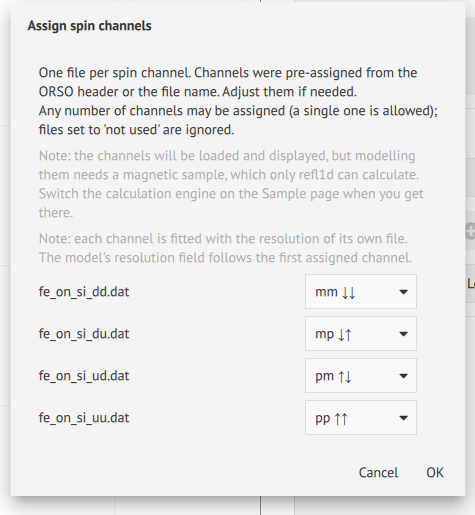
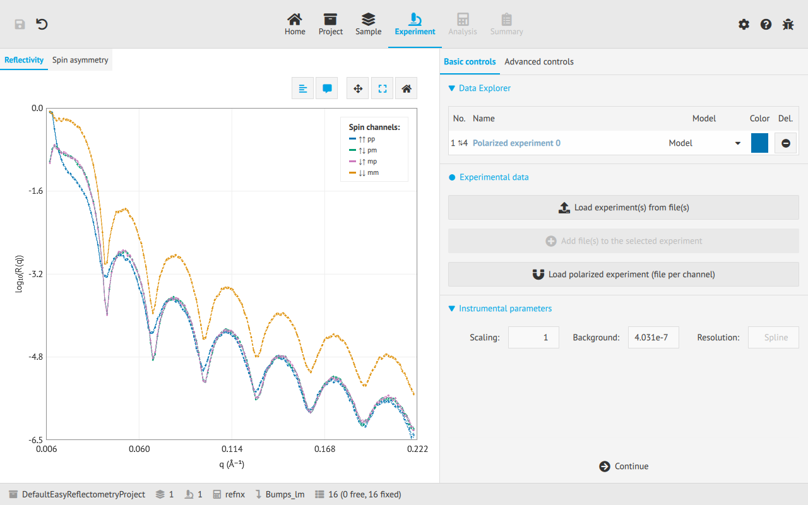
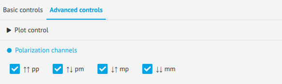
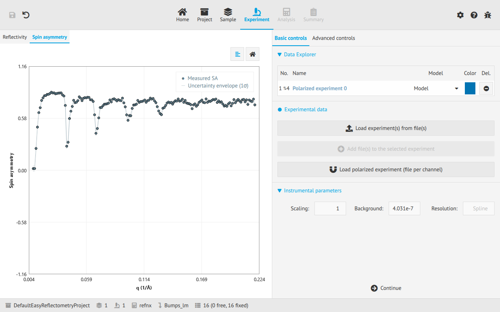
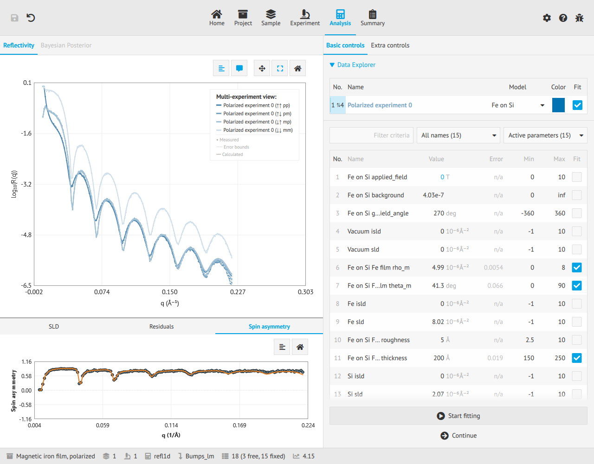
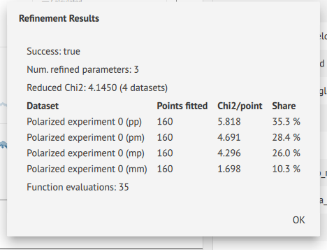

# Polarised data

A polarised measurement records up to four spin channels of the same sample. The app loads
them as one experiment, draws each channel on its own, and fits all of them together
against one model.

| Channel | Meaning |
|---|---|
| `pp` ↑↑ | non-spin-flip, both incoming and outgoing spin up |
| `mm` ↓↓ | non-spin-flip, both incoming and outgoing spin down |
| `pm` ↑↓ | spin-flip |
| `mp` ↓↑ | spin-flip |

The screenshots on this page use the four channels of a simulated iron film on silicon,
`fe_on_si_uu.dat`, `fe_on_si_ud.dat`, `fe_on_si_du.dat` and `fe_on_si_dd.dat` in
[`examples/datasets/polarized`](https://github.com/easyScience/EasyReflectometryApp/tree/master/examples/datasets/polarized).
The film is 200 Å thick, with `ρM = 5.0` and `θM = 40°`. The example
*Magnetic iron film, polarized* on the `Project` page loads the same files.

## Loading one file per channel

The **Experimental data** group on the `Experiment` page has three buttons. The third,
**Load polarized experiment (file per channel)**, opens a file picker for `.dat`, `.txt` and
`.ort` files. Select one file per spin channel (several at once is fine) and the
**Assign spin channels** dialog opens:



Each file gets a channel drop-down. The app fills it in from the `polarization` entry of
the ORSO header (`pp`, `pm`, `mp` or `mm`). If the file has no such header, it looks for a
channel in the file name, in the parts between separators such as `_`, `-` or `.`:

| Channel | File name parts |
|---|---|
| `pp` | `pp`, `uu`, `upup`, `up_up`, `plusplus`, `plus_plus` |
| `pm` | `pm`, `ud`, `updown`, `up_down`, `plus_minus` |
| `mp` | `mp`, `du`, `downup`, `down_up`, `minus_plus` |
| `mm` | `mm`, `dd`, `downdown`, `down_down`, `minusminus`, `minus_minus` |

For two-channel data, a single `up`, `u`, `plus` or `p` means `pp`, and `down`, `d`,
`minus` or `m` means `mm`. A header that declares another polarisation, such as
`unpolarized`, wins over the file name.

A file whose channel the app cannot detect starts as **not used**, and you can set any file
you want to leave out the same way. Check the drop-downs and correct anything wrong. One
channel on its own is enough.

**OK** stays disabled while a channel is assigned to more than one file, or no file is
assigned at all, and a red line under the files says which. If a file cannot be read when
you press **OK**, for example because it was moved in the meantime, the app refuses the
load and tells you why.

If the project's calculation engine cannot model magnetism, as with `refnx` in a new
project, the dialog also warns you: the channels will load and be drawn, but they cannot be
modelled until the sample has magnetic layers and the engine is `refl1d`. See
[magnetic layers](./magnetism.md).

```{note}
Each channel keeps the resolution of its own file. The fit, the per-channel curves on the
`Analysis` page and the report all smear a channel with its measured resolution. When the
model has no other experiment yet, the first loaded channel, in the order `pp`, `pm`, `mp`,
`mm`, sets the **Background** and **Resolution** in the **Instrumental parameters** group.
The resolution field shows `Spline` when that file has a resolution column; see
*Resolution of the data* in [loading experimental data](./load_data.md).
```

The new experiment takes its name from the ORSO title of the first file. Files without a
title, like the iron files, give `Polarized experiment` followed by a number.
**Add file(s) to the selected experiment** is disabled while a polarised experiment is
selected, because its channels are separate datasets.

## Seeing the channels

After loading, the `Experiment` page shows all four channels:



- The experiment chart draws one measured series with error bounds for each visible
  channel, in fixed colours (↑↑ `pp` blue, ↑↓ `pm` green, ↓↑ `mp` pink, ↓↓ `mm` orange),
  under a **Spin channels** legend.
- The `Data Explorer` on the `Experiment` and `Analysis` pages marks a polarised
  experiment with a `⇅N` badge, where `N` is the number of measured spin channels.

In the iron data, ↓↓ lies above ↑↑. With `θM = 40°` the moment points partly against the
guide field (`φ = 130°`, see [magnetic layers](./magnetism.md)), so the ↓↓ neutrons see the
higher scattering length density. The two spin-flip channels nearly coincide.

The **Polarization channels** group in the advanced controls of the `Experiment` page sets
which channels are drawn:



There is one checkbox per measured channel. Hiding a channel changes only the charts on
the `Experiment` and `Analysis` pages; the fit always uses every measured channel. At
least one measured channel stays visible, and the group is disabled while a fit is
running.

## Spin asymmetry

The spin asymmetry is

```
SA(q) = (R↑↑ − R↓↓) / (R↑↑ + R↓↓)
```

If the experiment measured both non-spin-flip channels, a **Spin asymmetry** tab appears
next to **Reflectivity** on the `Experiment` page (measured data only), and a third tab,
next to **SLD** and **Residuals**, in the lower panel of the `Analysis` page (measured data
and the model). If either channel is missing, neither tab is shown, and the `Experiment`
page has no tab strip at all.



The chart plots `|SA|`, the size of the asymmetry, so the sign is lost. The iron data have
`R↓↓ > R↑↑` and a negative `SA`, yet their points lie above zero. The
**Uncertainty envelope (1σ)** around the points comes from the channel uncertainties. The
chart drops two kinds of points, and a note below it says how many:

- points where `R↑↑ + R↓↓` is not significantly above zero, i.e. the background-dominated
  tail, which would otherwise ruin the axis scaling;
- points of the ↑↑ channel outside the `q` range of the ↓↓ channel. Inside the common
  range, the app interpolates ↓↓ onto the ↑↑ points when the two were measured at different
  `q`.

The y axis always covers `[−1, 1]`, with a small margin, and widens only if
background-subtracted data fall outside it.

## Fitting a polarised experiment

A fit of a polarised experiment uses all of its measured spin channels at once, against the
shared model. Thickness, roughness, nuclear SLD, scale and background are common to every
channel, and all channels together constrain `ρM` and `θM`. Polarised and ordinary
experiments can sit in the same refinement.

The example *Magnetic iron film, polarized* starts from a thickness of 180 Å, `ρM = 3.0`
and `θM = 60°`, with these three parameters free. Press **Start fitting** with the default
minimiser and it recovers the true structure:



| Parameter | Start | Fitted | True |
|---|---|---|---|
| thickness | 180 Å | 200.0 Å | 200 Å |
| `ρM` | 3.0 | 4.99 | 5.0 |
| `θM` | 60° | 41.3° | 40° |

The `Analysis` reflectivity chart draws one measured and calculated pair for each visible
channel, each with that channel's cross-section. A polarised experiment always uses the
multi-experiment view, so the channels come in shades of the experiment's colour from the
`Data Explorer`, with legend rows such as `Polarized experiment 0 (↑↑ pp)`. The
**Residuals** tab has one curve per visible channel, and the **Spin asymmetry** tab adds
the model's asymmetry as a line through the measured points.

If the model cannot calculate a channel, for example a spin-flip channel on a non-magnetic
sample, the chart shows only its measured points and the channel adds no residuals.

The **Refinement Results** dialog lists one row per channel, with the number of points, the
reduced χ² of that channel and its share of the total:



In the `Summary` report a polarised experiment also has one row per measured spin channel,
named like `Polarized experiment 0 (pp)`, and the report figures plot each channel in its own
colour. See [summary](./summary.md).

## Limitations

- Bayesian sampling does not support polarised experiments yet; see
  [Bayesian analysis](./bayesian.md).
- The app loads a polarised experiment only from one file per channel. An ORSO file that
  holds all channels as separate datasets has to be split into one file per channel first.
