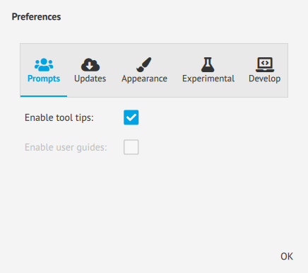
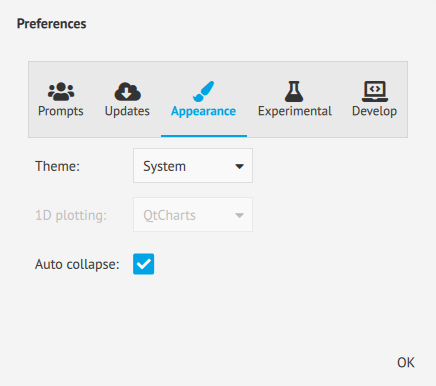

# Settings
The cog button in the top right corner opens the **Preferences** dialog from any page. Its
settings apply to the whole application rather than to one project. A change takes effect
as soon as you make it, and **OK** closes the dialog.

The dialog has five tabs.

## Prompts
**Enable tool tips** shows the short explanations that appear when you hover over a
button, a field or a table cell. Untick it to turn most of them off; a few fields, such as
the minimiser settings on the `Analysis` page, keep theirs. **Enable user guides** is
greyed out: the app has no user guides yet.

## Updates
**Check on application start** and **Check now** are placeholders: this version of the app
does not look for updates. New versions are listed on the
[installation](../installation.md) page and on the
[releases page](https://github.com/EasyScience/EasyReflectometryApp/releases).

## Appearance

- **Theme**: `Light`, `Dark`, or `System` to follow the operating system.
- **1D plotting** is greyed out. The charts are always drawn with `QtCharts`.
- **Auto collapse**: when you expand a group in a sidebar, the other groups on that page
  collapse, so only one is open at a time. Untick it to keep several groups open.

## Experimental
- **Zoom** scales the whole interface from 100 % to 150 %. The app starts at 100 % again
  the next time you open it.
- **Language** is empty: the app is available in English only.

## Develop
**Logging level** chooses how much the app reports in the terminal it was started from:
`Debug`, `Info`, `Error` or `Disabled`. It is meant for developers. In this version the
choice is saved but does not change what the terminal shows.
**Logging to** is greyed out.

The app remembers the tool tips, update, theme, auto collapse and logging choices for the
next session. The **Save automatically** preference is not in this dialog; it is in the
`Advanced controls` of the `Project` page (see [getting started](../tutorial.md)).
