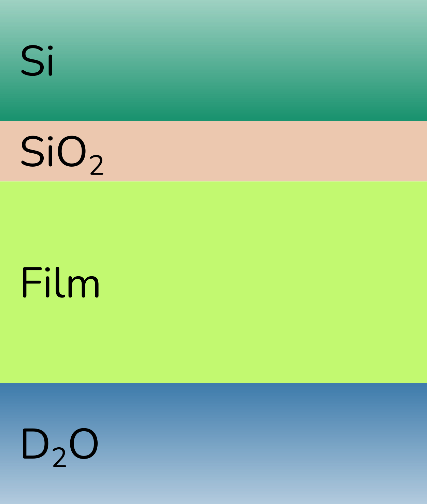
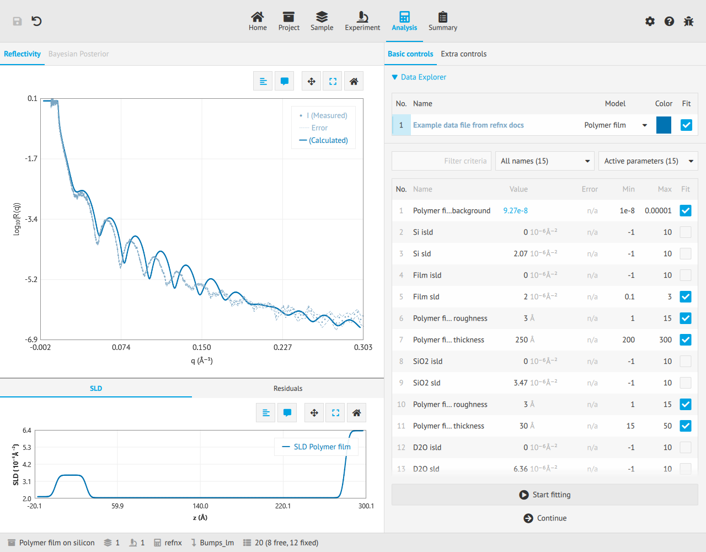
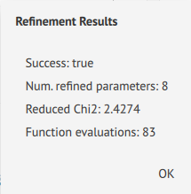
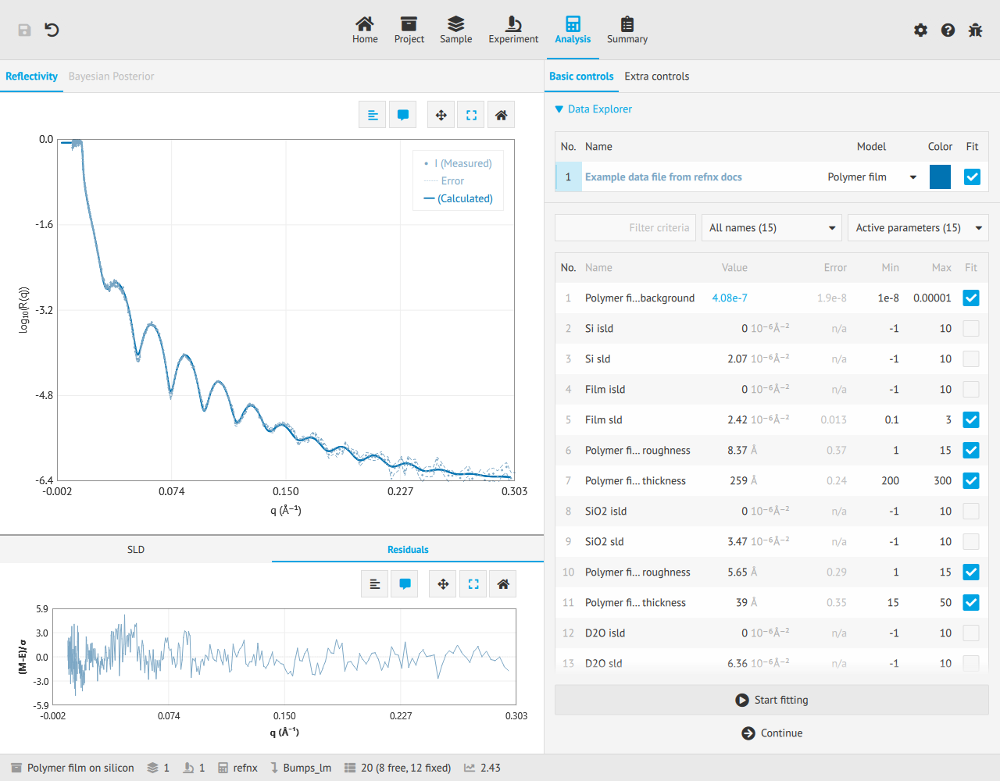
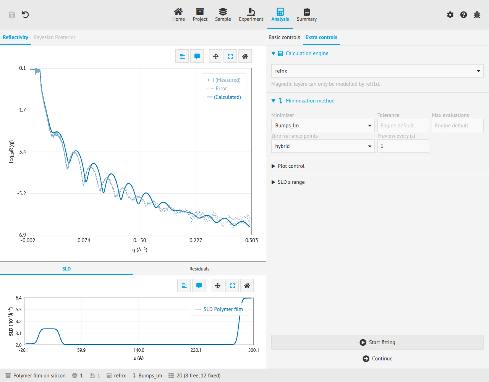

# Simple fitting with a slab model
This tutorial fits a simple slab model on the `Analysis` page. The ISIS Virtual
Reflectometry Training Course on [neutron reflectometry fitting](https://www.reflectometry.org/isis_school/intro.html)
explains the model in its [model-dependent analysis](https://www.reflectometry.org/isis_school/2_model_dependent_analysis/what_is_model_dependent_analysis.html)
and [reflectometry slab models](https://www.reflectometry.org/isis_school/3_reflectometry_slab_models/the_slab_model.html)
sections.

The sample is a polymer film on a silicon block, measured against heavy water
(D<sub>2</sub>O). The neutrons come in through the silicon, so silicon (Si) is the
super-phase. Silicon carries a thin native layer of silicon dioxide (SiO<sub>2</sub>), the
polymer film sits on that oxide, and the D<sub>2</sub>O below the film is the sub-phase.
As a slab model:



The example *Polymer film on silicon* on the `Project` page loads this model with data
measured on Platypus (ANSTO). The screenshots on this page use that example.

## The Analysis page
The `Analysis` page shows the measured data and the model's reflectivity in the
**Reflectivity** chart. The lower panel has an **SLD** tab with the model's scattering
length density profile and a **Residuals** tab (see [Residuals](#residuals) below). The
**Bayesian Posterior** tab next to **Reflectivity** becomes available after a Bayesian
sampling run; see [Bayesian analysis](./bayesian.md).

The charts have the same toolbar as those on the other pages: legend, coordinates on hover,
pan, box zoom and reset.

The sidebar has two tabs, `Basic controls` and `Extra controls`. Below both tabs are
**Start fitting** and **Continue**, which goes on to the `Summary` page.

## Basic controls



### Data Explorer
The **Data Explorer** lists the experiments. Each row shows the experiment's name (click
it to rename the experiment), the model it is fitted with, that model's colour, and a
**Fit** box that includes the experiment in the next fit. Click a row to select an
experiment. With several experiments, Ctrl+Click selects more than one; see
[fitting several contrasts together](./multi_contrast.md).

### The parameter table
The table below lists the parameters of the models and experiments. For each it shows the
**Value** with its unit, the **Error** (uncertainty) from the last fit, the **Min** and
**Max** limits, and a **Fit** box that makes the parameter free in the next fit.
**Select All**, under the last row, ticks or unticks **Fit** for every parameter in the
table. **Error** reads `n/a` until a fit has given the parameter an uncertainty.

- Click a row to select its parameter. The slider below the table then covers ±10 % of the
  current value, inside the limits, and sets the value when you release it. The two fields
  next to the slider show its range.
- Type a new value, min or max straight into the table. The rules are described under
  [Limits](#limits).
- A name starting with `ƒ` is a derived parameter, calculated from others; one starting
  with `⇄` is shared by several models. A shared parameter can be detached from the others
  for one model; see [fitting several contrasts together](./multi_contrast.md).
- While a fit runs, the table cannot be edited.

### Filtering the parameter table
The field and the two drop-downs above the table choose which parameters it lists.

- **Filter by name**: `All names`, `Model`, `Experiment` or `Background`, or type part of a
  name in the field to its left. `All names`, `Model` and `Experiment` show how many
  parameters they match. `Model` and `Experiment` go by what owns the parameter: only a
  model's scale and background are experiment parameters, whatever the others are called.
- **Filter by variability**, each with the number of parameters it matches:

| Choice | Lists |
|---|---|
| **Active parameters** (the default) | The parameters that can be edited and fitted. |
| **All parameters** | The same, plus the greyed rows: constrained and derived parameters, and parameters that currently do not affect the reflectivity. |
| **Free parameters** | The active parameters ticked for fitting. |
| **Fixed parameters** | The active parameters not ticked for fitting. |

A parameter that a constraint takes over disappears from the default view; switch to
**All parameters** to see its value.

### Limits
The app gives a new parameter default limits: -1 to 10 for an SLD (in
10<sup>-6</sup>Å<sup>-2</sup>), 0 to 10 for the scale, and 50 % to 200 % of the starting
value for a thickness or a roughness. You can change any of them. The example comes with
narrower limits of its own, such as 200 Å to 300 Å for the film thickness.

- The app keeps a min or max exactly as you typed it. If the current value lies outside the
  new limit, the value moves onto it. The app refuses a min at or above the max, or a max
  at or below the min.
- A value typed in the table stays within the limits next to it. Widen the limit first to
  go further.
- A value typed on the `Sample` page (a thickness, a roughness, an SLD, a `ρM`) has no
  limits beside it, so there the value wins and pushes any limit it passes out to the new
  value.

A limit outside what is physically possible (a negative thickness or roughness, an SLD
outside -1 to 10, a scale outside 0 to 10) turns red, and hovering it gives the
reason. The limit is still the one the fit uses; the colour only marks it as unusual.

A limit is also red when it is `inf` for a fitted parameter while the selected minimiser
needs finite limits for every fitted parameter.

## Fitting the polymer film

```{tutorial} Simple fitting
:id: simple-fitting
:example: PolymerFilm/project.json
:minutes: 5
:summary: Fit a slab model to a polymer film measured on Platypus.
```

```{tutorial-step} The sample
:id: sample
:page: project
:more: simple_fitting.md#simple-fitting-with-a-slab-model

The example *Polymer film on silicon* is loaded: a polymer film on a silicon block with its
native oxide, measured against heavy water (D₂O) on Platypus. The model has the film on the
oxide, with silicon as the super-phase and D₂O as the sub-phase.
```

```{tutorial-step} Open the Analysis page
:id: open-analysis
:target: appbar.analysisTab
:done: ui.page == 'analysis'
:do: goto analysis
:advance: auto
:more: simple_fitting.md#the-analysis-page

Open the **Analysis** page with its tab in the application bar.
```

```{tutorial-step} Compare the data and the model
:id: compare
:page: analysis
:target: analysis.reflectivityChart
:more: simple_fitting.md#the-analysis-page

The **Reflectivity** chart shows the measured data and the model's reflectivity. At the
starting values the calculated fringes are spaced too far apart: the film is thicker than
the 250 Å the model starts from.
```

```{tutorial-step} The parameters to fit
:id: parameters
:page: analysis
:sidebar-tab: basic
:target: analysis.parameterTable
:more: simple_fitting.md#the-parameter-table

Eight parameters are ticked **Fit**: the thickness and roughness of the oxide and of the
film, the film's SLD, the roughness towards the D₂O, the scale and the background. The SLDs
of Si, SiO₂ and D₂O are known and stay fixed.
```

```{tutorial-step} Start the fit
:id: start-fit
:page: analysis
:target: analysis.startFitting
:done: step.fits_finished >= 1 and fit.reduced_chi2 < 5
:do: click analysis.startFitting
:hint: The fit did not end with a good result. Press **Start fitting** again, or restart the tutorial to begin from the example's values.
:more: simple_fitting.md#starting-following-and-cancelling-a-fit

Press **Start fitting**, below the sidebar. With the default minimiser, `Bumps_lm`, the fit
takes about a second.
```

```{tutorial-step} Read the results
:id: results
:page: analysis
:done: not fit.results_dialog_open
:do: call analysis.setShowFitResultsDialog false
:more: simple_fitting.md#the-fit-results

The **Refinement Results** dialog reports the outcome: a reduced χ² of about 2.4, where 1
would mean the model describes the data within their uncertainties. Press **OK**. The table
now shows the fitted values with their uncertainties.
```

```{tutorial-step} Look at the residuals
:id: residuals
:page: analysis
:target: analysis.residualsTab
:done: ui.plot_tab == 'residuals'
:do: click analysis.residualsTab
:more: simple_fitting.md#residuals

Open the **Residuals** tab below the chart. After the fit, the residuals scatter around zero,
a little more widely at low q.
```

```{tutorial-step} Change a parameter
:id: thickness
:page: analysis
:sidebar-tab: basic
:target: analysis.parameterTable
:done: abs(params.value('polymer_film_film_thickness') - 200) < 5
:do: call analysis.setParameterValue polymer_film_film_thickness 200
:more: simple_fitting.md#the-parameter-table

Type `200` as the **Value** of *Polymer film Film thickness* in the table and press Enter.
The curve follows at once: the fringes move apart again.
```

```{tutorial-step} Fit with another minimiser
:id: minimizer
:page: analysis
:sidebar-tab: advanced
:target: analysis.minimizer
:done: fit.minimizer == 'LMFit_leastsq' and step.fits_finished >= 1 and fit.reduced_chi2 < 5
:do: sidebar-tab advanced; set analysis.minimizer LMFit_leastsq; click analysis.startFitting
:hint: Pick `LMFit_leastsq` as the **Minimizer** and press **Start fitting**.
:more: simple_fitting.md#minimization-method

Open **Extra controls**, pick `LMFit_leastsq` as the **Minimizer**, and press
**Start fitting**. It finds the film thickness again, about 258 Å. Not every minimiser does:
200 Å is the lower limit of the thickness, and `Bumps_lm` or `Bumps_simplex` stay stuck
there.
```

```{tutorial-step} Continue to the Summary
:id: summary
:page: analysis
:target: analysis.continue
:done: ui.page == 'summary'
:do: click analysis.continue
:advance: auto
:more: summary.md

Press **Continue** at the bottom of the sidebar. The `Summary` page reports the model, the
data and the fit, and exports them.
```

### The fit results
The **Refinement Results** dialog reports the outcome of a fit:



- **Num. refined parameters**: the number of parameters ticked **Fit**.
- **Reduced Chi2**: χ² divided by the degrees of freedom (number of points minus number of
  refined parameters). Around 1 means the model describes the data within their
  uncertainties.
- **Function evaluations**: how many times the fit calculated the model.

With several datasets in the fit, the dialog also has a table with each dataset's points,
χ² per point and share of the total χ². **Classical reduced Chi2** appears when the
handling of zero-variance points (see [Minimization method](#minimization-method)) makes it
differ from the reduced χ² above.

After **OK**, the table shows the fitted values with their uncertainties, and the
**Reduced Chi²** item in the status bar shows the result of the last fit:



| Parameter | Start | Fitted |
|---|---|---|
| Film thickness | 250 Å | 258.9 ± 0.2 Å |
| Film SLD | 2.0 | 2.42 ± 0.01 (10<sup>-6</sup>Å<sup>-2</sup>) |
| Film roughness | 3 Å | 8.4 ± 0.4 Å |
| SiO2 thickness | 30 Å | 39.0 ± 0.4 Å |
| SiO2 roughness | 3 Å | 5.6 ± 0.3 Å |
| Subphase roughness | 3 Å | 3.7 ± 0.1 Å |
| scale | 1 | 0.875 ± 0.003 |
| background | 9.3 × 10<sup>-8</sup> | (4.1 ± 0.2) × 10<sup>-7</sup> |

The fit ends at a reduced χ² of 2.43 after 83 evaluations. The calculated curve now
follows the fringes over the whole q range, and the residuals scatter around zero, a little
more widely at low q.

### Starting, following and cancelling a fit
The **Start fitting** button sits below the sidebar on both the `Basic controls` and the
`Extra controls` tabs. While a fit runs it reads **Cancel fitting**, and a progress bar
with a line of text appears under it: the number of evaluations so far (optimiser steps for
a BUMPS minimiser), the reduced χ² and the time elapsed. A fit has no knowable end, so the
bar only shows that it is running.

The same is shown in short form on every page except `Home`: a thin bar along the top of
the status bar, and a **Fit** item (e.g. `132 evaluations · reduced χ² 1.2345`) that takes
the place of the **Calculator** and **Minimizer** items for the duration of the run.

While the fit runs, the app redraws the reflectivity, residual and SLD curves with the best
values found so far, at most once per second and only when the fit has improved.
**Preview every (s)** in the `Extra controls` sets how often.

**Cancel fitting** stops any minimiser within one evaluation or step. The
**Refinement Cancelled** dialog then gives the reduced χ² and the number of evaluations
reached, with the parameters already at the best values found, and asks:

- **Keep current values**: the values stay but lose their uncertainties, and the
  status bar shows the reduced χ² marked as cancelled.
- **Revert to starting values**: the values and uncertainties go back to what they were
  when the fit started.

A fit cancelled before its first progress report goes back to the starting values without
asking.

If a fitted parameter has limits the fit cannot use, for example `inf` with a minimiser
that needs finite limits, the fit does not start. A dialog lists the parameters, and
**Show free parameters** filters the table down to them.

## Extra controls
The `Extra controls` tab holds the calculation engine, the minimiser and the chart
settings:



### Calculation engine
**Calculation engine** switches between `refnx` and `refl1d`. The same selector is in the
`Advanced controls` of the `Sample` page; both change the same project setting. Only
`refl1d` can model magnetic layers, so a sample with magnetism cannot be calculated with
`refnx`; see [magnetic layers](./magnetism.md).

### Minimization method
- **Minimizer**: the minimiser the fit uses. The choices are the LMFit methods
  (`LMFit_leastsq`, `LMFit_powell`, `LMFit_cobyla`, `LMFit_differential_evolution`,
  `LMFit_scipy_least_squares`), the BUMPS methods (`Bumps_simplex`, `Bumps_newton`,
  `Bumps_lm`) and `DFO_leastsq`. A new project fits with `Bumps_lm` (Levenberg-Marquardt);
  a loaded project keeps the minimiser it was saved with.
- **Tolerance** and **Max evaluations**: when to stop. Empty fields, which show
  `Engine default`, leave the choice to the minimiser. A BUMPS minimiser counts
  **Max evaluations** in optimiser steps, the others in function evaluations.
- **Zero-variance points**: what happens to points with zero uncertainty. The default,
  `hybrid`, applies the Mighell correction to those points and weighted least squares to
  the others; `mighell` applies the Mighell correction to all points; `legacy_mask` leaves
  the zero-variance points out.
- **Preview every (s)**: how often, in whole seconds, the app redraws the curves while a fit
  runs. 0 turns the preview off, and an empty field goes back to 1 s. It applies from the
  next fit.

Some minimisers have settings of their own, which appear below these as extra fields:
`epsfcn` for `LMFit_leastsq`, `diff_step` for `LMFit_scipy_least_squares`, `rhobeg` for
`DFO_leastsq`, and `strategy`, `popsize`, `mutation`, `recombination` and `seed` for
`LMFit_differential_evolution`. Hover a field for its meaning, and leave it empty for the
minimiser's default. The app refuses a value the minimiser cannot use and says why.

`LMFit_differential_evolution` needs finite limits for every fitted parameter. When some
are missing, a warning above the minimiser says how many.

Inequality constraints (see [model definition](./model_def.md)) need a BUMPS minimiser.
With an LMFit or DFO minimiser selected, a warning here says so and the fit does not start.
`Bumps_lm` enforces them only weakly, and the warning then suggests `Bumps_simplex` or
`Bumps_newton`.

The first entry of the **Minimizer** list, `BUMPS-DREAM (Bayesian)`, does not minimise
but samples the posterior distribution of the fitted parameters. It replaces the fields
above with its own sampling settings; see [Bayesian analysis](./bayesian.md).

### Plot control
The **Plot control** group sets how the reflectivity chart is drawn. The same group is in
the advanced controls of the `Sample` and `Experiment` pages, and the choice applies to all
three.

- **Plot R(q)×q⁴**: plots the reflectivity multiplied by q⁴, which flattens the Fresnel
  decay and brings out the fringes.
- **Linear R(q)-axis**: plots R(q) on a linear axis instead of a logarithmic one. This and
  **Plot R(q)×q⁴** exclude each other: ticking one unticks the other.
- **Logarithmic q-axis**: makes the q-axis logarithmic.
- **Show scale line** and **Show background line**: draw the model's scale and background
  as reference lines. They are not offered on the `Sample` page, which shows no measured
  data.

The axis title says what is plotted: R(q) or R(q)×q⁴ on a linear axis, log₁₀(R(q)) or
log₁₀(R(q)×q⁴) on a logarithmic one. When a model is magnetic, the group also has the
switches for the magnetic curves of the SLD chart; see [magnetic layers](./magnetism.md).

### SLD z range
**SLD z range** sets the z axis of the **SLD** chart. With **Auto**, the default, the axis
fits the calculated profiles. Untick it to type **z-min** and **z-max**, the range that
**Reset axes** returns to. The setting is shared with the `Sample` page and is not saved
in the project.

## Residuals
The lower panel of the `Analysis` page has three tabs: `SLD`, `Residuals` and, for a
polarised experiment that measured both non-spin-flip channels, `Spin asymmetry`.

The `Residuals` tab plots the weighted residual `(M-E)/σ` against `q`: the difference
between the model and the experiment, in units of the measured uncertainty. A good fit
scatters evenly around zero with no structure left in it; a systematic wave or a drift means
the model is missing something. The tab has the same legend, hover, zoom, pan and reset
controls as the other charts, and its q-axis follows the logarithmic setting of the
reflectivity chart.

With several experiments, or with a polarised experiment, the tab draws one residual curve
per visible measured series. A spin channel the model cannot calculate contributes no
residuals.
