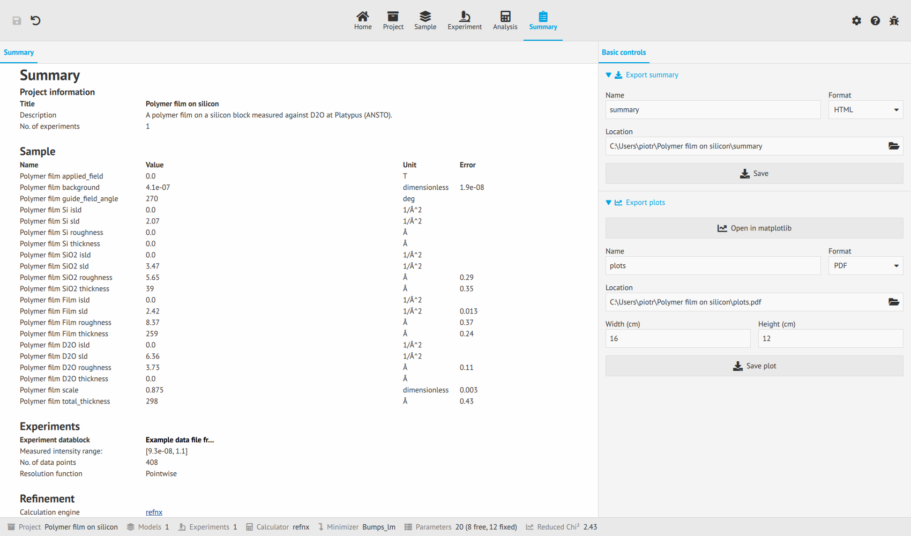
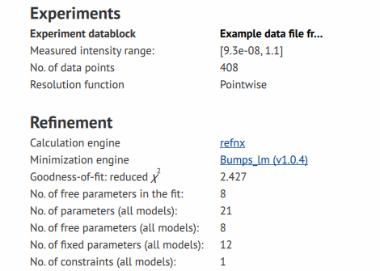
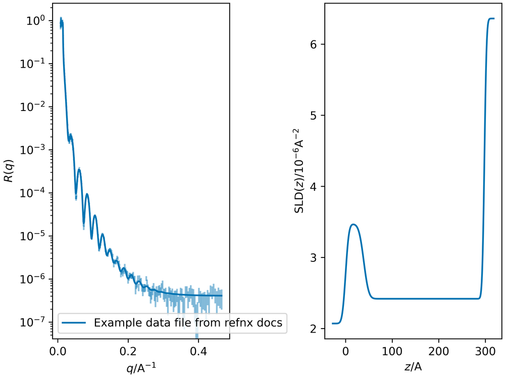

# Summary

The `Summary` page puts the project, the sample parameters, the loaded experiments and the
result of the last fit into one report, and saves the report or the charts to disk. The tab
becomes available when you press **Continue** on the `Analysis` page, load an example or
open a project. The report is there before any fit, and it updates as you change the
project, so after a fit it shows the fitted values.

The screenshots on this page show the *Polymer film on silicon* example after a fit with the
default settings, as in [simple fitting](./simple_fitting.md):



## The report

The report has four sections.

**Project information** gives the title and description of the project and the number of
loaded experiments.

**Sample** lists every parameter of every model, as `Name`, `Value`, `Unit` and `Error`.
The name is made of the model, the layer or material the parameter belongs to, and the
parameter itself, as in `Polymer film Film thickness`. A parameter that several models
share, such as an assembly that a [contrast](./multi_contrast.md) shares with its reference
model, is listed once, with the model names joined by `+`. The table also holds parameters
that the `Analysis` page does not show, such as the imaginary SLD (`isld`) of each material
and the magnetic field settings `applied_field` and `guide_field_angle`.

The `Error` column shows the uncertainty from the last fit. A parameter that was not fitted,
or any parameter before the first fit, has no uncertainty, and its `Error` cell is empty.
Derived values such as `total_thickness` get an uncertainty from the parameters they are
calculated from.

```{note}
The report does not wrap its lines. In a narrow window, or with a long project description,
the `Unit` and `Error` columns are pushed out of view on the right, and the page cannot be
scrolled sideways. Make the window wider to see them, or export the report.
```

**Experiments** has one block per measured dataset:



- **Experiment datablock**: the name of the experiment. A name longer than 20 characters is
  cut short; hover over it to see all of it.
- **Measured intensity range**: the smallest and largest measured reflectivity, not the
  `q` range.
- **No. of data points**.
- **Resolution function**: `Pointwise` when the file has a resolution column,
  `PercentageFwhm` with its percentage for a constant resolution, or `LinearSpline`.

A polarised experiment has one block per measured spin channel, named like
`Polarized experiment 0 (pp)`; see [polarised data](./polarized_data.md).

**Refinement** describes the last fit:

- **Calculation engine** and **Minimization engine**, each a link to its documentation.
  The minimiser is the one the last fit used, with the version of its package.
- **Goodness-of-fit: reduced χ²** of that fit, over all fitted datasets. It is `N/A` before
  the first fit.
- **No. of free parameters in the fit**: the parameters that fit varied. `N/A` before the
  first fit, or when the last fit did not finish.
- **No. of parameters**, and how many of them are **free**, **fixed** and
  **constraints**, counted over all models as the project stands now. A constraint is a
  parameter calculated from others, either by a constraint you set or by the app, such as
  `total_thickness`. It is neither free nor fixed.

With more than one model, the report ends with an **All Samples** table: the index, name,
number of assemblies and layers of each model, and the model it is a contrast of.

## Export summary

The **Export summary** group saves the report.

- **Name**: the file name, without extension. The default is `summary`.
- **Format**: `HTML` or `PDF`.
- **Location**: the full path of the file, without the extension, which the app adds. The
  default is the project folder, for the example `C:\Users\<you>\Polymer film on silicon`.
  The folder icon picks another folder and keeps the name. The folder is created if it does
  not exist.
- **Save** writes the file. The **Save confirmation** dialog then shows the path as a link
  you can click to open the file.

Both formats contain the report and two figures, the SLD profile of every model and the
measured and calculated reflectivity:

- **HTML**: the figures are interactive plotly charts. You can zoom, pan, read values by
  hovering, and hide a dataset by clicking its legend entry. The plotly library is stored in
  the file itself, so the report opens without an internet connection; this makes the file
  about 5 MB.
- **PDF**: the figures are static images, because the PDF converter cannot run the
  interactive charts. They follow the report. The app also leaves the two images,
  `sld_plot.jpg` and `fit_experiment_plot.jpg`, in the project folder, even when the PDF is
  saved somewhere else. The PDF has no **All Samples** table.

The reflectivity figure draws each dataset of the last fit with the curve it was fitted to,
or every loaded dataset when there has been no fit. A polarised experiment is drawn with one
colour per spin channel. With more than one experiment, each is shifted up by a factor of
10 from the one before, and its legend entry says by how much, e.g. `(×10)`.

## Export plots

The **Export plots** group draws the reflectivity and the SLD profile with matplotlib, as
one figure with two panels:



- The left panel shows the measured data with error bars and the calculated curve of each
  experiment, or of each spin channel of a polarised experiment. With more than one
  experiment, each is shifted up by a factor of 10 from the one before. Without experiments,
  it shows the calculated curve of each model.
- The right panel shows the SLD profile of each model. With several models, each profile is
  shifted up by 10 × 10⁻⁶ Å⁻² from the one before.
- The shifts are not marked in the legend, and only the reflectivity panel has a legend.

The controls:

- **Open in matplotlib** opens the figure in a matplotlib window without saving it. Use it
  for a quick look, or for matplotlib's own zoom, pan and save tools.
- **Name**: the file name, without extension. The default is `plots`.
- **Format**: `PDF`, `PNG`, `SVG` or `PICKLE` (see below).
- **Location**: the full path of the file, with the extension of the chosen format. The
  default is the project folder. The folder icon picks another folder.
- **Width (cm)** and **Height (cm)**: the size of the figure, 16 × 12 cm by default. Images
  are saved at 600 dpi.
- **Save plot** writes the file and shows the **Save confirmation** dialog.

### Saving charts as matplotlib objects

`PDF`, `PNG` and `SVG` are finished images, so the chart can no longer be edited. **PICKLE**
saves the matplotlib `Figure` object itself, as a `.pickle` file, which you can open and
change in any Python session:

```python
import pickle
import matplotlib.pyplot as plt

with open('plots.pickle', 'rb') as handle:
    figure = pickle.load(handle)

plt.show()
```

The loaded figure belongs to `pyplot` again, with its axes, curves, scales and data intact.
Choose this format when you want to keep working on the chart, for example to:

- restyle it for a paper or a talk (colours, fonts, legend, axis limits),
- add curves from another source to the same axes,
- read the plotted values back; with one experiment,
  `figure.axes[0].lines[0].get_xydata()` gives the measured points and `lines[1]` the
  calculated curve,
- save it in any image format later with `figure.savefig(...)`.

The file is written with Python's standard `pickle` module; reading it needs matplotlib
installed. As with any pickle file, only open files you trust.
